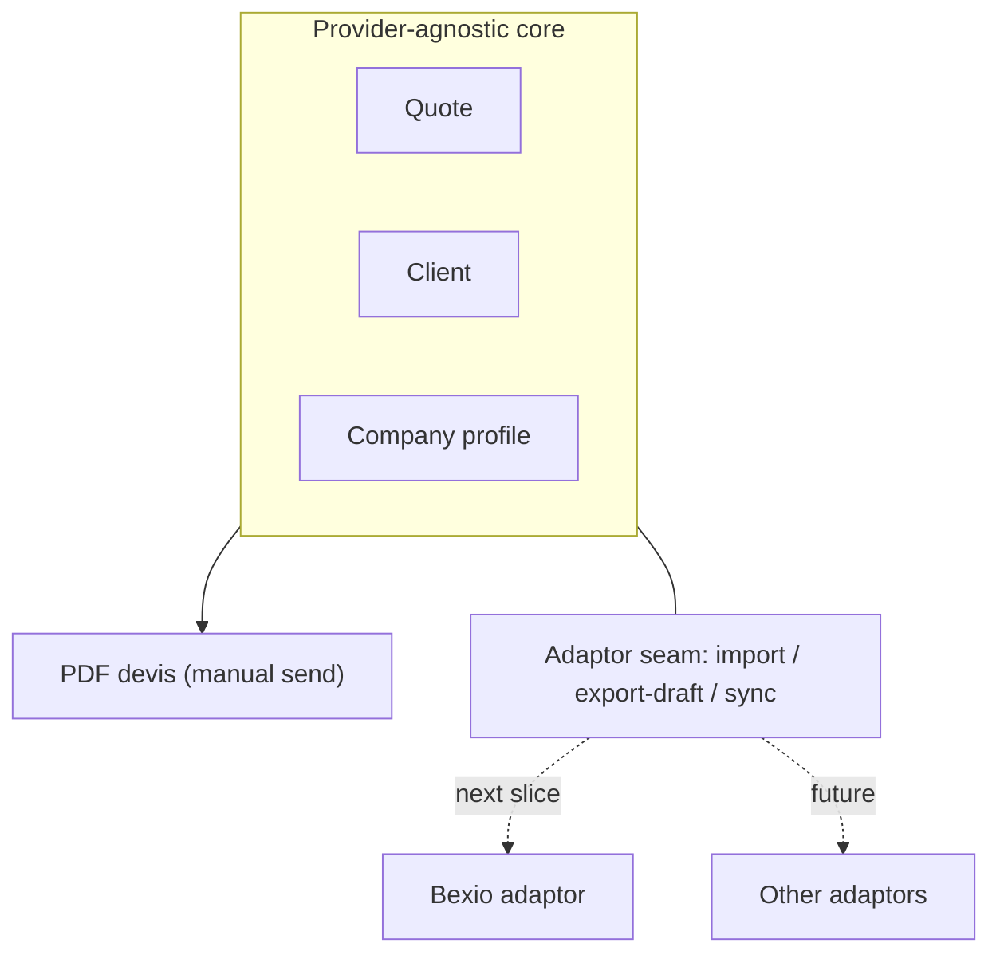

# Standalone voice-first quoting MVP — requirements

## Summary

A standalone, voice-first quoting app for tradespeople. Nicolas dictates a job, the tool parses and flags it, he edits and saves it, manages it in a library by status (Draft → Ready → Sent), and produces a printable PDF devis to hand a client — with no external system connected. A provider-agnostic core (Company, Client, Quote) sits behind a clean adaptor seam; Bexio is the first adaptor (import/sync), built in the very next slice.

---

## Problem Frame

The tool was framed as a voice front-end that drafts quotes into Bexio, and the parse loop is now proven on a real note. But binding the product to Bexio narrows it to Bexio users and makes a third-party account a hard dependency before the user gets any value.

What a tradesperson actually needs after dictating is to finish the quote and put a real document in a client's hands — which does not require Bexio at all. Today an edited draft is ephemeral (render-only, lost on refresh), and there is no way to produce a client-ready devis. The cost is twofold: work is lost between sessions, and the tool can't yet complete the one job it exists for.

---

## Key Decisions

- **Standalone-first; Bexio optional.** The app delivers a complete quote — dictate → edit → save → PDF — with no provider connected. Bexio becomes an optional sync, not the destination.
- **Provider-agnostic core behind a clean adaptor seam.** Company, Client, and Quote are modeled on the domain. A thin adaptor boundary (import / export-as-draft / sync) is defined from day one; only the seam ships now, and the Bexio adaptor is the next slice.
- **Bexio is a mapping, not the mold.** Bexio's real-world shapes are a reference, but the core reflects what a quote, client, and company are for any trade — so a second adaptor doesn't fight a Bexio-shaped core.
- **Single-owner for now.** Everything belongs to one implicit owner (Nicolas); no accounts or auth yet. When to introduce accounts is deferred.
- **Manual send.** "Send" means produce a PDF and download it; delivery happens outside the app.
- **Status is auto-derived.** A quote is Draft while it has unresolved flagged lines and Ready once they are resolved; Sent is the one transition the builder sets by hand.
- **Capture overrides from the first save.** When a saved line's rate differs from its catalog candidate, log the override. Prediction stays deferred; the log is the data that later enables it.

---

## Actors

- A1. Builder (Nicolas) — dictates, edits, saves, manages the library, produces the PDF.
- A2. Client — receives the PDF devis; passive, outside the app.
- A3. Provider system (Bexio, later others) — source of imported clients/company/catalog and a sync target, reached through an adaptor.

---

## Key Flows

- F1. Voice to saved draft
  - **Trigger:** Builder records a note or uploads audio.
  - **Steps:** transcribe → extract → compute and flag → editable render → Builder edits flagged lines → Save.
  - **Outcome:** a persisted Quote in the library, status auto-derived.
  - **Covered by:** R1, R3, R6, R8, R10
- F2. Library management
  - **Trigger:** Builder opens the library.
  - **Steps:** see saved quotes with status → reopen one → edit → save; mark a quote Sent.
  - **Outcome:** quotes persist and move through their lifecycle.
  - **Covered by:** R4, R5, R6, R7
- F3. Produce a devis
  - **Trigger:** Builder sends a Ready quote.
  - **Steps:** attach a client → preview the PDF → download → mark Sent.
  - **Outcome:** a client-ready document, delivered manually.
  - **Covered by:** R12, R13, R15, R16
- F4. Connect a provider (next slice)
  - **Trigger:** after the first saved draft, the app offers to connect Bexio.
  - **Steps:** open Settings → connect adaptor → import clients / company / catalog.
  - **Note:** the adaptor implementation and this connect flow are the next slice; the seam and the entry point are designed now.

---

## Requirements

**Core & persistence**
- R1. Company, Client, and Quote are persisted under a single implicit owner.
- R2. The core data model is provider-agnostic — no Bexio-specific fields in it.
- R3. A quote saved once survives refresh and return visits, and can be reopened and edited.

**Quote lifecycle & library**
- R4. The library lists saved quotes with their status.
- R5. Status is one of Draft, Ready, Sent.
- R6. Draft vs Ready is derived from whether the quote has unresolved `needs_review` lines; Sent is set when the builder marks it.
- R7. Any quote can be reopened from the library and edited.

**Editing & flagging**
- R8. Flagged (`needs_review`) lines are visually distinct and editable inline; `review_notes` show at the top.
- R9. Editing a quantity or rate recomputes the amount by the server's rounding rule; totals stay read-only.

**Override log**
- R10. On save, when a line's spoken rate differs from a catalog candidate price, an override is logged (line, spoken rate, candidate price, timestamp). No prediction is performed.

**Clients**
- R11. Clients are stored and manageable (add/edit), entered manually for now.
- R12. A quote has one client attached at send time.

**Company profile & settings**
- R13. A company profile holds the issuer details a devis needs — logo, address, VAT number, and the like.
- R14. Settings houses the company profile and the provider-connection entry point.

**PDF devis**
- R15. A quote renders as a printable PDF carrying company profile, client, line items with quantity/rate/amount, and HT/TVA/TTC.
- R16. The builder previews and downloads the PDF; delivery is manual.

**Adaptor seam**
- R17. A thin adaptor boundary defines import (clients/company/catalog), export-as-draft, and sync, with no implementation required to ship the foundation.
- R18. The first-saved-draft moment is reserved as the provider-connection entry point; the connect flow itself ships with the Bexio adaptor.

---

## Acceptance Examples

- AE1. **Covers R6.** Given a saved quote with one or more unresolved `needs_review` lines, its status is Draft. When every flagged line is resolved, status becomes Ready. Sent is never auto-set.
- AE2. **Covers R10.** Given a line where the builder keeps a spoken rate of 13 against a catalog candidate of 15, saving logs an override of {line, 13, 15}. Given a line whose rate equals its candidate, no override is logged.
- AE3. **Covers R15, R16.** Given a Ready quote with a client attached and a complete company profile, previewing produces a PDF showing issuer details, client, all lines, and HT/TVA/TTC, which the builder can download.
- AE4. **Covers R3.** Given a saved quote, closing and reopening the app leaves it in the library with its values and status intact.

---

## Scope Boundaries

**Deferred for later**
- Bexio adaptor implementation (import/sync) — the next slice; the seam ships now.
- Accounts and auth — single-owner now; account-creation timing TBD.
- Bexio draft write-back / export — after the import adaptor.
- Catalog learning / rate prediction — the override log is captured now; prediction is later.
- Standard-terms / boilerplate on the devis.
- Second-builder / multi-trade support.

**Outside this product's identity**
- Becoming a full accounting or invoicing system — it produces quotes, not books.
- Replacing Bexio — the app complements and syncs; it does not try to be the ledger.
- Sending email or SMS from the app — delivery stays manual and external.

---

## Dependencies / Assumptions

- A persistence backend is assumed; Supabase is available in the stack and the natural candidate, but the final choice is planning's.
- The existing parse pipeline in `src/quote/` produces the Quote that gets saved; the output contract is `refs/quote-schema.md`.
- The existing Bexio read client in `src/bexio/` and the catalog snapshot inform the adaptor's reference shapes and the next-slice import.
- Single-owner means no per-record ownership field is load-bearing yet, but the model must not preclude adding one.

---

## Success Criteria

Done when Nicolas can dictate a job, save it, find it in the library by status, and download a client-ready PDF devis — without connecting Bexio — and the foundation exposes an adaptor seam the Bexio slice can fill without reshaping the core.

---

## Outstanding Questions

**Resolve before planning**
- None blocking — the foundation slice is specified.

**Deferred to planning / later**
- When to prompt account creation (after the first draft is the working hypothesis).
- PDF generation approach.
- The exact core schema fields and how the adaptor boundary maps them onto Bexio.
- Sync direction and conflict resolution once the Bexio adaptor lands.
