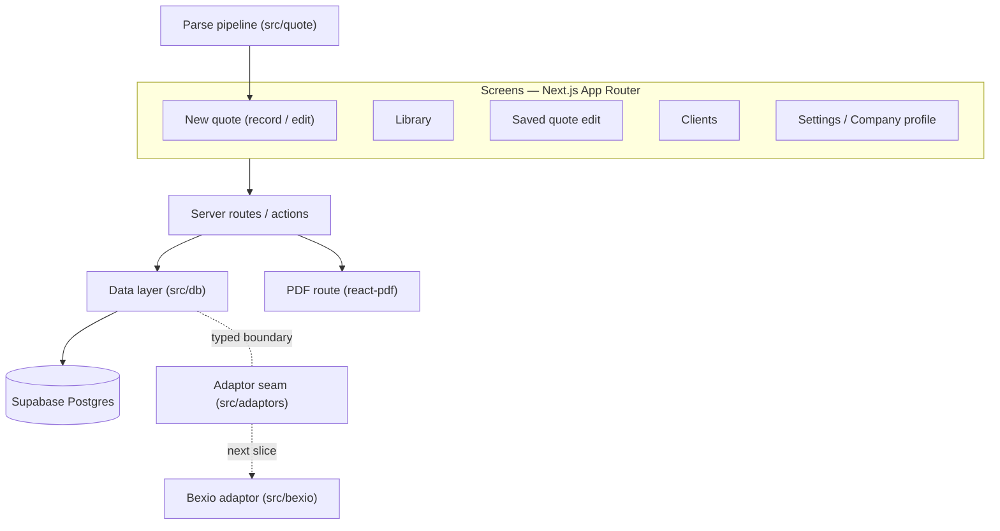
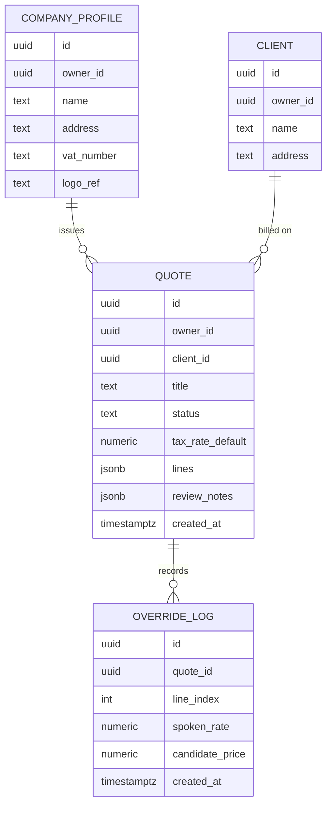
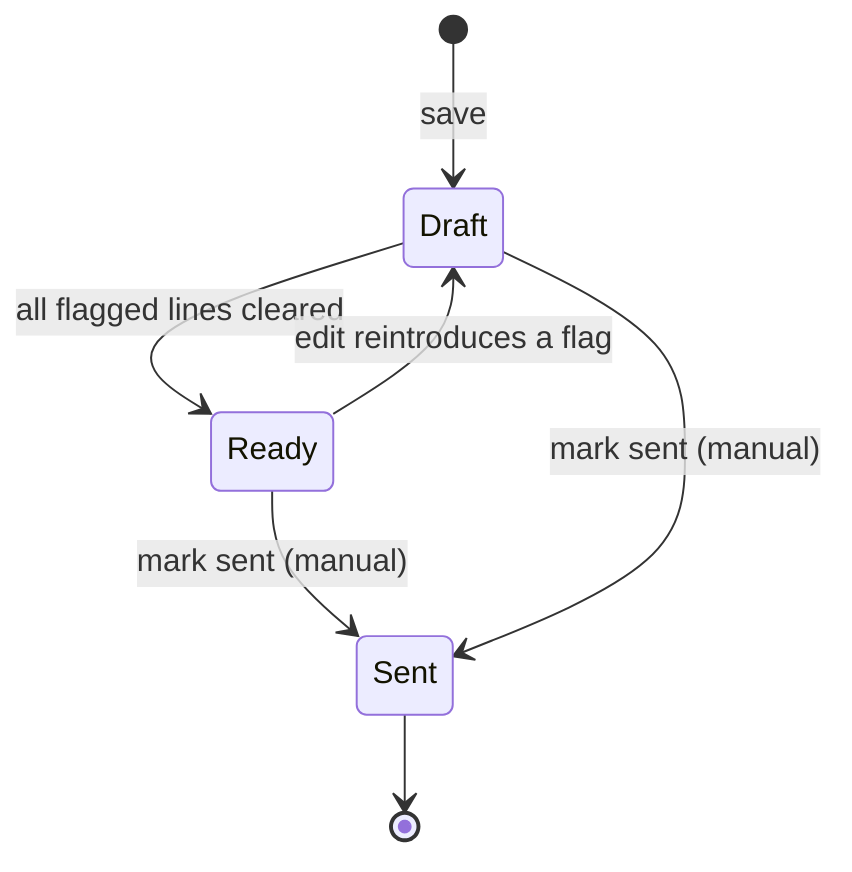

# feat: Standalone quoting foundation slice — persistence, library, clients, PDF

## Summary

Turn the proven voice → parse → edit screen into a usable standalone app: save a quote, manage saved quotes in a library by status (Draft → Ready → Sent), enter clients manually, set a company profile, and download a printable PDF devis. Build a provider-agnostic core (Company, Client, Quote) behind a typed adaptor seam; the Bexio adaptor is the explicit next slice and is not implemented here.

---

## Problem Frame

The parse loop works end-to-end on a real note, but an edited quote is ephemeral — it lives only in the page's React state and is lost on refresh. There is no library, no client, no company identity, and no way to produce a document a client can receive. The tool can't yet finish the one job it exists for: hand a tradesperson a real devis.

This slice closes that gap without any external system. It also sets the foundation the wider MVP depends on — a provider-agnostic data model behind an adaptor seam — so the Bexio adaptor (and later others) plugs in without reshaping the core. See `origin` for the full product framing.

---

## Requirements

Carried from the origin requirements doc (same R-IDs). This slice covers all of them except the Bexio adaptor implementation, which is deferred to the next slice.

**Core & persistence**
- R1. Company, Client, and Quote are persisted under a single implicit owner.
- R2. The core data model is provider-agnostic — no Bexio-specific fields in it.
- R3. A quote saved once survives refresh and return visits, and can be reopened and edited.

**Quote lifecycle & library**
- R4. The library lists saved quotes with their status.
- R5. Status is one of Draft, Ready, Sent.
- R6. Draft vs Ready is derived from whether the quote has unresolved `needs_review` lines; Sent is set when the builder marks it.
- R7. Any quote can be reopened from the library and edited.

**Editing & flagging**
- R8. Flagged (`needs_review`) lines are visually distinct and editable inline; `review_notes` show at the top.
- R9. Editing a quantity or rate recomputes the amount by the server's rounding rule; totals stay read-only.

**Override log**
- R10. On save, when a line's spoken rate differs from a catalog candidate price, an override is logged (line, spoken rate, candidate price, timestamp). No prediction is performed.

**Clients**
- R11. Clients are stored and manageable (add/edit), entered manually for now.
- R12. A quote has one client attached at send time.

**Company profile & settings**
- R13. A company profile holds the issuer details a devis needs — logo, address, VAT number, and the like.
- R14. Settings houses the company profile and the provider-connection entry point.

**PDF devis**
- R15. A quote renders as a printable PDF carrying company profile, client, line items with quantity/rate/amount, and HT/TVA/TTC.
- R16. The builder previews and downloads the PDF; delivery is manual.

**Adaptor seam**
- R17. A typed adaptor boundary defines import (clients/company/catalog), export-as-draft, and sync, with no implementation required to ship the foundation.
- R18. The first-saved-draft moment is reserved as the provider-connection entry point; the connect flow ships with the Bexio adaptor.

---

## Key Technical Decisions

- KTD1. **Persistence on Supabase Postgres.** It is the stack's available datastore; a relational shape maps cleanly to the future Bexio adaptor and to multi-tenant later. Access is server-side via the service role for now — single-owner, no client auth.
- KTD2. **Quote lines stored as a JSON column; Company and Client normalized.** The line shape is a frozen contract (`refs/quote-schema.md`, `src/quote/types.ts`); a JSON column preserves it without re-declaring it as columns and avoids drift, and the adaptor maps the JSON to Bexio positions at sync time. Fully normalizing lines was rejected — it duplicates the contract and risks divergence (see Alternatives).
- KTD3. **`owner_id` on every row from day one, set to one constant owner.** Single-owner now, multi-tenant later with no schema change. Auth and Supabase RLS are deferred to the accounts slice.
- KTD4. **PDF via `@react-pdf/renderer` in a server route, streamed as a download.** No Chromium, runs in any Node route, small and fast; flexbox layout is enough for a devis. Puppeteer was rejected — Chromium weight plus a separate rendering service is the wrong shape for a lean Railway deploy (see Sources).
- KTD5. **The adaptor seam is a typed boundary** (`import` / `export-as-draft` / `sync`) with no implementation. Core entities carry no provider fields. The existing read client in `src/bexio/` is the basis for the future Bexio adaptor but is not wired into the core.
- KTD6. **Status derives from line review state.** A quote is Draft while any line has an unresolved `needs_review` flag, Ready once all are cleared by a per-line "marquer vérifié" action, and Sent when set by hand. Document-level `review_notes` are informational and do not gate Ready.
- KTD7. **One shared editor.** Extract the inline quote editor from `app/page.tsx` into a shared client component used by both the new-quote screen and the saved-quote edit screen — one editor, one rounding/recompute path (the same `round2` rule as the server).

---

## High-Level Technical Design

Architecture — screens talk to server routes, which use a thin data layer over Supabase; the parse pipeline feeds new quotes; the adaptor seam sits beside the data layer, unimplemented.



Data model — Company and Client normalized; Quote holds its lines as JSON; overrides logged per quote/line.



Status lifecycle — derived from line flags, except the manual Sent transition.



---

## Output Structure

New directories and files this slice introduces (per-unit `Files` lists remain authoritative):

```text
supabase/migrations/        # SQL schema for company_profile, clients, quotes, override_log
src/db/                     # data layer: client, quotes, clients, company, overrides
src/adaptors/               # typed adaptor seam (interface only)
src/quote/status.ts         # status derivation from line flags
app/quotes/                 # library + saved-quote edit screens
app/clients/                # client management screen
app/settings/               # company profile + provider-connection placeholder
app/components/             # shared QuoteEditor, QuoteDocument (PDF)
app/api/quotes/, app/api/clients/, app/api/company/   # server routes
```

---

## Implementation Units

### Phase A — Foundation

### U1. Provider-agnostic data model + Supabase persistence

- **Goal:** Stand up the Supabase schema and a server-side data layer for Company, Client, Quote, and the override log, with `owner_id` on every row.
- **Requirements:** R1, R2, R3
- **Dependencies:** none
- **Files:**
  - `supabase/migrations/0001_core_schema.sql` (create)
  - `src/db/client.ts` (create — server-side Supabase client, service role from env)
  - `src/db/quotes.ts`, `src/db/clients.ts`, `src/db/company.ts`, `src/db/overrides.ts` (create — typed CRUD)
  - `src/db/types.ts` (create — row types; Quote `lines` typed as the existing `Line[]` from `src/quote/types.ts`)
  - `src/db/owner.ts` (create — the single constant `owner_id`)
  - `.env.example` (modify — add `SUPABASE_URL`, `SUPABASE_SERVICE_ROLE_KEY`)
- **Approach:** Quote row stores `lines` and `review_notes` as JSON (KTD2); Company/Client normalized. The data layer is the only module that imports the Supabase client — screens and routes call it, never the DB directly. No RLS yet (KTD3); access is service-role server-side.
- **Patterns to follow:** mirror the thin-wrapper, env-guarded style of `src/bexio/client.ts` (read token from env, never log it, surface errors with status). Reuse `Line`/`Quote` types from `src/quote/types.ts` rather than re-declaring line shape.
- **Test scenarios:**
  - Happy path: `src/db/quotes.ts` round-trips a Quote (insert → fetch by id) preserving every line's `expression`, `value`, `amount`, and `needs_review`.
  - Covers AE4. A saved quote fetched in a fresh call returns identical values and status.
  - Edge: fetching a non-existent id returns null, not a throw.
  - Note: DB integration tests run against a local/test Supabase instance — provisioning and the live connection are execution-time (see Open Questions). Pure mapping/serialization is unit-testable without a live DB.
- **Verification:** A Quote can be written and read back through the data layer with its line shape intact; `owner_id` is populated on every row.

### U2. Adaptor seam (typed boundary, no implementation)

- **Goal:** Define the provider-agnostic adaptor interface so "Bexio is one of many" is structural, with zero implementation.
- **Requirements:** R2, R17, R18
- **Dependencies:** U1
- **Files:**
  - `src/adaptors/types.ts` (create — `Adaptor` interface: `importClients`, `importCompany`, `importCatalog`, `exportDraft`, `sync`, plus a capability descriptor)
  - `src/adaptors/index.ts` (create — registry stub returning no adaptors yet)
- **Approach:** Interface only, typed against the core entities (Company, Client, Quote) — not Bexio shapes. No registration of the Bexio adaptor here. The first-saved-draft connect entry point (R18) is reserved in the Settings placeholder (U8), not built.
- **Patterns to follow:** keep the interface domain-named (e.g., `importClients(): Promise<Client[]>`), referencing core types from `src/db/types.ts` / `src/quote/types.ts`.
- **Test expectation:** none — type-only boundary, compile-time checked; `npx tsc --noEmit` must stay clean.
- **Verification:** The interface compiles against the core types and names no provider-specific field; the registry returns empty.

### Phase B — Save, library, status

### U3. Extract the shared QuoteEditor component

- **Goal:** Move the inline quote render/edit UI out of `app/page.tsx` into a reusable client component so new-quote and saved-quote screens share one editor.
- **Requirements:** R8, R9
- **Dependencies:** none (refactor; enables U4, U6)
- **Files:**
  - `app/components/QuoteEditor.tsx` (create — the `QuoteView` + editing handlers from `app/page.tsx`, plus the per-line "marquer vérifié" control used by U4)
  - `app/page.tsx` (modify — consume `QuoteEditor`; keep recorder/upload/loading)
- **Approach:** Lift state-shape and handlers verbatim; the editor takes a `Quote` and emits edits. Preserve the existing `round2` recompute on quantity/rate edits and the read-only totals (R9). No behavior change beyond extraction.
- **Patterns to follow:** the current `QuoteView` and edit handlers in `app/page.tsx`; `totalsFromLines` / `round2` from `src/quote/`.
- **Test scenarios:**
  - Happy path: editing a quantity recomputes amount via `round2`; totals update; identical output to pre-refactor for the Amina fixture.
  - Edge: a forfait line shows the forfait control, no quantity field.
  - Test expectation: component behavior covered by a render test asserting the recompute; visual parity verified against the existing page.
- **Verification:** `app/page.tsx` renders identically using the extracted component; the Amina fixture still shows TTC 4715.60 and editable fields.

### U4. Save a quote: persistence, status derivation, override log

- **Goal:** Persist an edited quote, derive its status from line flags, let the builder clear flags and mark Sent, and log rate overrides on save.
- **Requirements:** R3, R5, R6, R10
- **Dependencies:** U1, U3
- **Files:**
  - `src/quote/status.ts` (create — `deriveStatus(quote): "Draft" | "Ready" | "Sent"` from unresolved `needs_review` lines + a stored `sent` marker)
  - `src/quote/status.test.ts` (create)
  - `app/api/quotes/route.ts` (create — `POST` create/update; computes status; writes override-log rows)
  - `app/components/QuoteEditor.tsx` (modify — Save action; per-line "marquer vérifié" clears that line's `needs_review`; "marquer envoyé" sets Sent)
- **Approach:** On save, persist the Quote (U1), recompute status (KTD6), and for each line where `price_override === true` write an override-log row (line index, spoken rate, the compared candidate price, timestamp) (R10). Clearing a flag flips `needs_review` to false on that line; status re-derives. Doc-level `review_notes` do not affect status.
- **Patterns to follow:** `price_override` derivation already in `src/quote/compute.ts`; reuse it to decide what to log.
- **Test scenarios:**
  - Covers AE1. A quote with one unresolved flagged line derives Draft; clearing the last flag derives Ready; Sent is never auto-set.
  - Covers AE2. A line keeping spoken rate 13 against candidate 15 logs `{line, 13, 15}` on save; a line whose rate equals its candidate logs nothing.
  - Edge: a quote with no flagged lines derives Ready immediately on first save.
  - Error: save with no client is allowed (client attaches at send, U7), but PDF/send is blocked until a client exists (asserted in U9).
- **Verification:** Saving persists the quote, status reflects flag state, overrides appear for diverging rates only.

### U5. Quote library with status

- **Goal:** A screen listing saved quotes with their status, each reopenable.
- **Requirements:** R4, R7
- **Dependencies:** U1, U4
- **Files:**
  - `app/quotes/page.tsx` (create — list: title, client, status badge, total, date; link to edit)
  - `app/api/quotes/route.ts` (modify — `GET` list for the owner)
- **Approach:** Server-render the owner's quotes ordered by recency; status badge styled like the existing `needs_review` highlight vocabulary. Each row links to `app/quotes/[id]`.
- **Patterns to follow:** the card/badge styles in `app/globals.css`; French labels as on `app/page.tsx`.
- **Test scenarios:**
  - Happy path: three saved quotes with differing statuses render with the right badges and totals.
  - Edge: empty library shows an empty state, not an error.
- **Verification:** Saved quotes appear with correct status and link to their editor.

### U6. Reopen and edit a saved quote

- **Goal:** Load a saved quote into the shared editor, edit, and re-save.
- **Requirements:** R7, R3
- **Dependencies:** U1, U3, U4
- **Files:**
  - `app/quotes/[id]/page.tsx` (create — fetch by id, render `QuoteEditor`, Save)
  - `app/api/quotes/[id]/route.ts` (create — `GET` one, `PUT` update)
- **Approach:** Reuse `QuoteEditor` (U3) and the save path (U4). Editing a Ready quote that reintroduces a flag re-derives it to Draft (per the state machine).
- **Test scenarios:**
  - Happy path: open a saved quote, change a rate, save; the change persists and totals/status update.
  - Covers AE4. Reopening after a reload shows the persisted values.
  - Edge: opening an unknown id shows a not-found state.
- **Verification:** A saved quote reopens with its values, edits persist, status re-derives.

### Phase C — Clients, company profile

### U7. Client management + attach to quote

- **Goal:** Store and manage clients (manual add/edit) and attach one to a quote at send time.
- **Requirements:** R11, R12
- **Dependencies:** U1
- **Files:**
  - `app/clients/page.tsx` (create — list + add/edit form)
  - `app/api/clients/route.ts`, `app/api/clients/[id]/route.ts` (create — CRUD)
  - `app/components/QuoteEditor.tsx` (modify — client selector for the quote)
- **Approach:** Minimal CRUD over the normalized `clients` table; the quote stores `client_id` (set when sending, U9). Manual entry only — import is the Bexio slice.
- **Test scenarios:**
  - Happy path: create a client, edit it, attach it to a quote; `client_id` persists.
  - Edge: a quote with no client attached is valid until send.
  - Error: creating a client with an empty name is rejected.
- **Verification:** Clients persist and can be attached to a quote.

### U8. Company profile + Settings

- **Goal:** A Settings screen holding the company profile (issuer details a devis needs) and a placeholder for the provider connection.
- **Requirements:** R13, R14
- **Dependencies:** U1
- **Files:**
  - `app/settings/page.tsx` (create — company profile form + disabled "Connecter Bexio (bientôt)" placeholder)
  - `app/api/company/route.ts` (create — `GET`/`PUT` the single owner's profile)
- **Approach:** One company profile per owner (upsert). Logo handling is minimal for now — store a reference; the storage mechanism is an Open Question. The provider-connection control is a visible-but-disabled placeholder marking the R18 entry point (the connect flow is the next slice).
- **Test scenarios:**
  - Happy path: save a profile (name, address, VAT number); reload shows the saved values.
  - Edge: VAT number and logo are optional; saving without them succeeds.
- **Verification:** The profile persists and is available to the PDF (U9); the provider placeholder is present and inert.

### Phase D — Output

### U9. PDF devis generation and download

- **Goal:** Render a quote as a printable PDF carrying company profile, client, lines, and totals; preview and download.
- **Requirements:** R15, R16
- **Dependencies:** U1, U4, U7, U8
- **Files:**
  - `app/components/QuoteDocument.tsx` (create — `@react-pdf/renderer` document: header with company profile + logo, client block, line table, HT/TVA/TTC)
  - `app/api/quotes/[id]/pdf/route.ts` (create — render to a PDF stream with download headers)
  - `app/quotes/[id]/page.tsx` (modify — preview + download action)
  - `package.json` (modify — add `@react-pdf/renderer`)
- **Approach:** Server route fetches the quote + client + company profile and streams the PDF (KTD4). Amounts come straight from the stored line `amount`/totals — no recompute in the PDF layer. Download via response headers; preview opens the same route.
- **Patterns to follow:** totals via `totalsFromLines` from `src/quote/totals.ts` for the displayed HT/TVA/TTC.
- **Test scenarios:**
  - Covers AE3. A Ready quote with a client and a complete company profile produces a PDF containing issuer details, client, every line with quantity/rate/amount, and HT/TVA/TTC.
  - Error: requesting the PDF for a quote with no client attached returns a clear error, not a malformed document.
  - Edge: a forfait line renders without a quantity column value.
- **Verification:** The PDF downloads and shows the full devis with correct numbers for the Amina quote.

---

## Acceptance Examples

Carried from origin; enforced by the test scenarios above.

- AE1. **Covers R6.** A saved quote with unresolved `needs_review` lines is Draft; when every flagged line is cleared it becomes Ready; Sent is never auto-set. (U4)
- AE2. **Covers R10.** Keeping spoken rate 13 against candidate 15 logs an override of `{line, 13, 15}`; a rate equal to its candidate logs nothing. (U4)
- AE3. **Covers R15, R16.** A Ready quote with a client and a complete company profile produces a downloadable PDF showing issuer details, client, all lines, and HT/TVA/TTC. (U9)
- AE4. **Covers R3.** A saved quote survives closing and reopening with values and status intact. (U1, U6)

---

## Scope Boundaries

**Deferred for later** (from origin)
- Bexio adaptor implementation (import/sync) — the next slice; the seam ships now.
- Accounts and auth — single-owner now; account-creation timing TBD.
- Bexio draft write-back / export — after the import adaptor.
- Catalog learning / rate prediction — the override log is captured now; prediction is later.
- Standard-terms / boilerplate on the devis.
- Second-builder / multi-trade support.

**Outside this product's identity** (from origin)
- Becoming a full accounting or invoicing system — it produces quotes, not books.
- Replacing Bexio — the app complements and syncs; it does not try to be the ledger.
- Sending email or SMS from the app — delivery stays manual and external.

**Deferred to Follow-Up Work** (plan-local)
- Supabase RLS and per-owner isolation — lands with the accounts slice (KTD3).
- Logo upload storage — U8 stores a reference; the upload/storage mechanism is an Open Question.
- Quote delete / archive from the library — not required for the foundation.

---

## Risks & Dependencies

- **New dependency: Supabase project.** Provisioning, the connection string, and the service-role key are execution-time. Without them the data layer can't run; the existing keyless fixture path on `app/page.tsx` keeps the parse loop demoable in the meantime.
- **New dependency: `@react-pdf/renderer`.** Flexbox-only layout — fine for a devis, but complex table layouts would need workarounds. Acceptable for this output.
- **Single-owner shortcut.** Skipping auth/RLS now is deliberate (KTD3) but means the deployed app is unauthenticated; keep it private until the accounts slice.
- **Editor refactor (U3) is load-bearing.** Both the new-quote and saved-quote screens depend on it; verify visual/behavioral parity before building U4/U6 on top.

---

## Alternatives Considered

- **Fully normalized quote lines (rows per line) instead of JSON.** More queryable per line and a closer 1:1 to Bexio positions, but it re-declares the frozen line contract (`refs/quote-schema.md`) as columns and invites drift between the SQL shape and the parse output. Rejected for the foundation; the adaptor can map JSON → positions at sync time (KTD2).
- **Puppeteer/Chromium for pixel-perfect HTML-to-PDF.** Better for complex layouts, but pulls a headless browser and a rendering service into a lean Railway deploy. Rejected for this MVP (KTD4).

---

## Open Questions

Deferred to implementation or a later slice — none block this plan.

- Logo storage mechanism (Supabase Storage vs a URL reference) — resolve when building U8.
- Exact Supabase client setup and local test-DB strategy for U1 integration tests — resolve at execution.
- Account-creation prompt timing — product question, after-first-draft is the working hypothesis (next slice).
- Sync direction and conflict resolution — belongs to the Bexio adaptor slice.

---

## Sources / Research

- PDF approach grounded in a server-side comparison of `@react-pdf/renderer` vs Puppeteer (no-Chromium, sub-second, serverless-friendly vs pixel-perfect-but-heavy): [@react-pdf vs Puppeteer](https://dev.to/iurii_rogulia/pdf-generation-on-the-server-puppeteer-vs-react-pdfrenderer-a-production-comparison-44cg), [React PDF generation in 2026](https://viprasol.com/blog/react-pdf-generation/).
- Existing code to build on: parse pipeline and types in `src/quote/`, the frozen output contract in `refs/quote-schema.md`, the env-guarded client style in `src/bexio/client.ts`, and the inline editor in `app/page.tsx`.
- Origin requirements: `docs/brainstorms/2026-06-08-standalone-quoting-mvp-requirements.md`.
