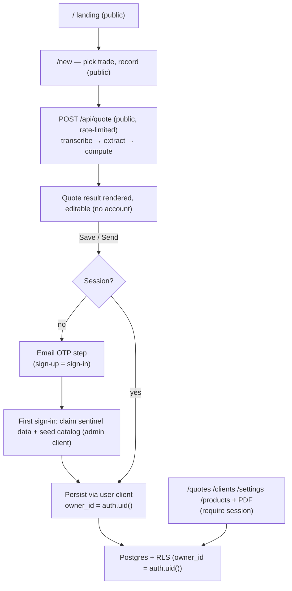
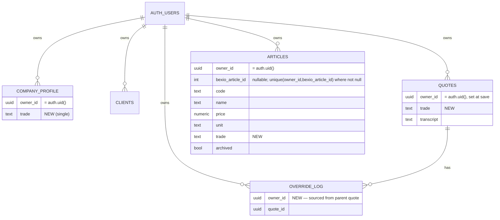

# feat: Auth + multi-user (Supabase email-OTP + RLS), anonymous capture, and catalog → owner-scoped articles with trade

## Summary

Turn Kobio from a single-implicit-owner app into a real multi-user product, and in the same flow move the catalog off the on-disk `refs/catalog.json` snapshot into an owner-scoped `articles` table with a per-user trade.

The product shape is **anonymous capture, auth-at-save**: anyone can land, pick their trade, **record, and see the parsed quote with no account**. Identity is created only at **Save / Send**, by keying in an email and a one-time code — which doubles as sign-up *and* sign-in. `owner_id` is assigned at that moment and the just-parsed quote persists under the new (or returning) user. Authentication is **Supabase Auth (email OTP)**; tenant isolation is **Postgres RLS** keyed on `owner_id = auth.uid()`. The single-owner shortcut (`OWNER_ID` constant + service-role client that bypasses RLS) is replaced by a request-scoped user client for owner data, with the service-role client retained only for admin/seed/backfill. Existing pilot data (Soufflet profile, 1 client) is claimed onto Nicolas's account on his first authenticated save.

Catalog data becomes per-owner rows seeded from the snapshot; a single `company.trade` (one trade per builder — no multi-trade) plus `article.trade` and `quote.trade` let the dictation flow scope the LLM's candidate set to the builder's métier, chosen before recording.

This is the **"accounts slice"** the foundation plan explicitly deferred (see foundation-plan KTD3): `owner_id` already exists on every table precisely so this lands with no structural reshaping.

---

## Problem Frame

The foundation slice deliberately shipped single-owner: every row carries `owner_id = OWNER_ID` (a constant), all DB access goes through one service-role client that **bypasses RLS**, and there is no auth. The deployed app is therefore unauthenticated and unsafe to expose — it was meant to stay private until this slice (foundation-plan risk: "the deployed app is unauthenticated; keep it private until the accounts slice").

Three things must become true:

1. **Identity + isolation.** Real users exist, and one builder can never read or write another's quotes, clients, company profile, or catalog — enforced at the database, not just in app code.
2. **Frictionless entry.** A first-time builder should get *value before commitment*: record a job and see the chiffrage with no signup. Account creation (email OTP) happens only when they save or send — the moment they actually need persistence.
3. **Per-owner catalog.** `refs/catalog.json` is a single global file (no owner, read from `process.cwd()`, gitignored). It cannot represent per-user catalogs and cannot be written back to as override-learning matures. It becomes an owner-scoped table, and the builder's single trade narrows the LLM candidate set.

---

## Origin & Context (carried forward)

From `docs/brainstorms/2026-06-08-standalone-quoting-mvp-requirements.md` and the foundation plan:

- **KTD3 (foundation plan):** `owner_id` on every row from day one; "multi-tenant later with no schema change. Auth and Supabase RLS are deferred to the accounts slice." → This plan *is* that slice.
- **KTD1 (foundation plan):** service role "for now — single-owner, no client auth." → Replaced here for owner data.
- **Provider-agnostic core** behind an adaptor seam — preserved. The Bexio import/sync adaptor stays a **separate** slice; `articles.bexio_article_id` is reserved as its future target.
- **Override log** captures spoken-vs-catalog rate deltas (R10); the catalog becomes a writable table so that can later converge prices, but **prediction stays deferred**.
- `src/db/owner.ts` `OWNER_ID` is the single thing assuming one owner; demoting it to seed/backfill-only is a core deliverable.

---

## Key Technical Decisions

- **KTD-A. Auth provider + channel: Supabase Auth, email OTP.** Native to the stack and makes RLS first-class (`auth.uid()` == stored `owner_id`). Email OTP (a one-time code to the builder's email) works out of the box on Supabase — no SMS provider, no per-message cost. **Production note:** Supabase's built-in email sender is rate-limited and not meant for production volume; wire a custom SMTP provider before public launch (cheap/free tier, no per-message auth cost). (Phone SMS OTP was the considered alternative — rejected for SMS-provider cost/config; see Alternatives.)
- **KTD-B. Isolation: Postgres RLS, `owner_id = (select auth.uid())`.** Database-enforced, so an app-code mistake cannot leak cross-tenant rows. Four policies per owner-scoped table. App-level `owner_id` filters remain as defense-in-depth.
- **KTD-C. Anonymous capture, auth-at-save.** `/` (landing) and `/new` (record → parse → view result) and the parse endpoint `POST /api/quote` are **public/anonymous** — no session required to produce a chiffrage. Authentication (email OTP) is triggered at the **Save / Send** step; everything that reads or writes persisted owner data (`POST/PUT /api/quotes`, PDF, `/quotes`, `/clients`, `/settings`, `/products`) requires a session. This replaces the earlier "protect the whole app" stance.
- **KTD-D. `owner_id` is assigned at first authenticated save.** The quote is parsed anonymously (no owner). On Save, if there is no session, the email-OTP step runs, creating or signing in the user; the quote is then persisted with `owner_id = auth.uid()`. `OWNER_ID` is removed from the live path. Inserts derive `owner_id` **solely from the session** (`currentOwnerId()`), never from a request body, with a DB `default auth.uid()` backstop.
- **KTD-E. Two client kinds via `@supabase/ssr`.** A **request-scoped user client** (`createServerClient` reading the session cookie; created per request, never cached in a module global) for all owner data — RLS applies. A **service-role admin client** retained only for operations that must bypass RLS: the one-time data claim/backfill and the catalog seed. `app/**` must never import the admin client (enforced by lint).
- **KTD-F. `articles` table replaces `refs/catalog.json` at runtime.** Owner-scoped, RLS-protected, `bexio_article_id` reserved for the future import. `loadCatalog()` (file) → `listArticles(trade?)` (DB, owner-scoped). The snapshot demotes to a seed source.
- **KTD-G. One trade per builder — no multi-trade.** `company_profile.trade text` (single), `articles.trade text` (per-article tag, nullable), `quotes.trade text` (the trade active at dictation). The trade is **required before recording**: defaulted from `company.trade` for returning (authenticated) users, picked manually by anonymous first-timers. Taxonomy is a fixed code-side constant (`peinture, plomberie, electricite, maconnerie, menuiserie, carrelage, multiservices`) stored as `text`, validated app-side, carrying display labels.
- **KTD-H. Trade refines extraction, never overrides a spoken price.** The candidate set sent to the LLM is scoped to the builder's trade — fewer, cleaner candidates. It never changes the faithful-transcription rule: a spoken price always wins (CLAUDE.md hard rule).
- **KTD-I. `override_log` gets `owner_id`, sourced from its parent quote.** Add `owner_id` for a uniform RLS policy. Set it from the just-saved quote's `owner_id` (not an independently session-derived value) so an override row can never be owned by a different tenant than its quote. Enforce the invariant with a test (and optionally a DB check).
- **KTD-J. Claim existing pilot data on first authenticated save.** When Nicolas first signs in (email OTP), reassign the `OWNER_ID`-sentinel rows (Soufflet profile, client, quotes, override_log) to his real `auth.uid()` and seed his catalog from the snapshot — idempotently, guarded against the `0003` one-profile-per-owner constraint. New users start with an empty catalog.
- **KTD-K. The public parse endpoint is rate-limited.** Because `POST /api/quote` is now anonymous and fronts paid STT + LLM calls, it is an abuse/cost surface. Add IP-based rate limiting (and a per-session cap) before public exposure.

---

## High-Level Technical Design

Anonymous-capture / auth-at-save flow:

Data model after this slice:

Every owner-scoped table gets `enable row level security` + four policies (`select/insert/update/delete`) of the shape `using ((select auth.uid()) = owner_id)` (plus `with check` on insert/update).

---

## Scope Boundaries

**In scope**
- Supabase email-OTP sign-up/sign-in surfaced at save/send; session middleware (refresh + gate the protected routes only).
- Anonymous capture: `/`, `/new`, `POST /api/quote` public; save/send/library/clients/settings/products gated.
- RLS on all owner-scoped tables; request-scoped user client; service-role retained for admin/seed only.
- `owner_id` from session (assigned at save), `OWNER_ID` constant demoted; DB `default auth.uid()` backstop.
- Claim of existing sentinel rows + catalog seed on Nicolas's first sign-in.
- `articles` table + data layer; Produits reads from DB; extraction reads owner+trade-scoped articles.
- Single trade (`company.trade`, `article.trade`, `quote.trade`); trade required before record; trade in Réglages.
- Rate limiting on the public parse endpoint.

### Deferred to Follow-Up Work
- Bexio import/sync adaptor that *populates* `articles`/clients/company — its own slice (origin F4). This plan reserves `bexio_article_id` and seeds from the local snapshot only.
- Article create/edit UI on Produits (this slice ships read + trade display; the `articles` data layer exposes write methods so the UI is a thin add-on later).
- Rate prediction / catalog learning from the override log.
- Account recovery hardening (email change, lost-inbox recovery) and an optional phone-OTP channel as a future alternative.

### Deferred for later (from origin)
- Bexio draft write-back / export; standard-terms boilerplate on the devis.

### Outside this product's identity (from origin)
- Team/org accounts (multiple users sharing one company). One-user-one-tenant here; the model does not preclude a future `org_id`.
- Becoming an accounting/invoicing system; replacing Bexio; sending email/SMS *content* (the OTP email is auth infra, not message delivery).

---

## System-Wide Impact

- **Every `src/db/*` module** moves from the single service-role `db()` to a request-scoped user client + `currentOwnerId()`. Highest blast radius: `quotes.ts`, `clients.ts`, `company.ts`, `overrides.ts`, `articles.ts` (new), plus callers in `app/api/*` and server components under `app/quotes`, `app/clients`, `app/settings`, `app/products`.
- **`POST /api/quote`** stays anonymous (parse only) and gains rate limiting; it loads the owner's trade-scoped articles only once a session exists (anonymous parse uses no catalog candidates, or the trade-picked seed for the pilot). **Save/PUT/PDF** become gated.
- **`/new`** carries the required trade selector and the save-time OTP handoff (return to the in-progress quote after auth).
- **TopNav** gains an account affordance with anonymous / loading / authenticated states; landing stays public.
- **Deployment/env:** add `NEXT_PUBLIC_SUPABASE_URL` + `NEXT_PUBLIC_SUPABASE_PUBLISHABLE_KEY`; keep `SUPABASE_SERVICE_ROLE_KEY` server-only. Email OTP needs no SMS provider; configure custom SMTP in Supabase before public launch for email volume/deliverability (KTD-A).

---

## Implementation Units

Phase A and Phase B ship in the same release — RLS without the user client (or vice versa) is a security regression, not a safe midpoint.

### Phase A — Auth foundation (email OTP, anonymous-capture-aware)

### U1. Supabase client factories + env + middleware session refresh
- **Goal:** `@supabase/ssr` browser/server/middleware clients + env; keep the service-role client as the admin client; middleware refreshes the session without gating public routes.
- **Requirements:** KTD-A, KTD-C, KTD-E.
- **Dependencies:** none.
- **Files:** `package.json` (add `@supabase/ssr`); `.env.example` (add `NEXT_PUBLIC_SUPABASE_URL`, `NEXT_PUBLIC_SUPABASE_PUBLISHABLE_KEY`; note service-role server-only); `src/db/supabase/server.ts` (create — `userClient()` per request via `createServerClient` + `cookies()`; **no module-global cache**); `src/db/supabase/browser.ts` (create); `src/db/client.ts` (modify — keep service-role as `adminClient()`, create per call, drop the module-level cache); `middleware.ts` (create — session refresh per the `@supabase/ssr` proxy pattern; matcher excludes static).
- **Approach:** Follow the current `@supabase/ssr` pattern exactly (cookie `getAll`/`setAll`; call `getClaims()` immediately after client creation; return the response object verbatim). Middleware refreshes only — gating lives in U3. Never cache either client in a module global (Fluid Compute).
- **Patterns to follow:** existing `src/db/client.ts` env-validation + 10s timeout-bound fetch.
- **Test scenarios:** `userClient()` with no cookie → anonymous client, no throw; with a valid cookie → `getClaims()` resolves the user id; `adminClient()` still throws a clear error on missing env; two requests with different cookies resolve different `auth.uid()` (no cross-request bleed); middleware passes static paths untouched.
- **Verification:** Navigation refreshes the auth cookie without spurious logout; admin client works for a scripted read.

### U2. Email-OTP auth at save + account affordance
- **Goal:** An email-OTP step (enter email → emailed code) surfaced at the Save/Send moment and reusable as sign-in; an account affordance in the nav; full error/loading states.
- **Requirements:** KTD-A, KTD-C, KTD-D.
- **Dependencies:** U1.
- **Files:** `app/components/AuthOtp.tsx` (create — email + code client component using the browser client; `signInWithOtp({email})` then `verifyOtp({type:'email'})`); `app/auth/signout/route.ts` (create); `app/components/TopNav.tsx` (modify — anonymous "Se connecter" / loading placeholder / authenticated email+sign-out). No full-page `/login` wall (anonymous capture); a `/login` route may exist as a direct entry but the primary surface is the save-time step.
- **Approach:** OTP runs inline in the save flow (modal/step), not as an app-wide gate. Enumerate error states with French copy: invalid email, invalid/expired code, rate-limited, email-send/delivery failure, network. On success the session is set and the pending save resumes (see U5/U10 handoff). For production, custom SMTP configured in Supabase (KTD-A); the built-in sender suffices for dev/staging.
- **Patterns to follow:** `app/clients/ClientManager.tsx` / `app/settings/CompanyForm.tsx` field + error styling; Kobio card/Fraunces/orange-button system.
- **Test scenarios:** valid email → code sent → valid code → session created; invalid/expired code → in-form French error; rate-limit and send-failure surface distinct messages (no silent failure); sign-out clears session → lands on `/`; nav shows anonymous vs authenticated vs a non-flashing loading state.
- **Verification:** A new visitor completes email OTP at save and is signed in across a reload; a returning email signs in via the same step.

### U3. Route protection model (public capture, gated persistence) + returnTo
- **Goal:** Gate only the persisted-data surfaces; keep capture public; after save-time OTP, return to the in-progress quote.
- **Requirements:** KTD-C, KTD-E.
- **Dependencies:** U1, U2.
- **Files:** `middleware.ts` (modify — redirect unauthenticated requests for gated *page* routes to the OTP entry with a `next` param; leave `/`, `/new`, `/api/quote`, `/auth/*`, static public); `src/db/auth.ts` (create — `requireUser()` for gated routes/components, `currentOwnerId()` from the session, and a `getOptionalUser()` for the parse path).
- **Approach:** Enumerate explicitly: **public** = `/`, `/new`, `POST /api/quote`; **gated** = `POST/PUT /api/quotes`, `GET /api/quotes/[id]/pdf`, `/api/clients`, `/api/company`, `/quotes`, `/clients`, `/settings`, `/products`. Middleware is the first gate; every gated route/component re-checks via `requireUser()` (middleware is not an authz boundary alone). returnTo: a save attempt without a session captures the in-progress quote, runs OTP, then completes the save and routes to the saved quote — no data loss.
- **Patterns to follow:** the `@supabase/ssr` redirect block (issue redirects via the `supabaseResponse` object, not a fresh `NextResponse`, or cookies are dropped).
- **Test scenarios:** anonymous GET `/new` renders (public); anonymous `POST /api/quote` succeeds (public); anonymous GET `/quotes` redirects to the OTP entry; anonymous `POST /api/quotes` returns 401; after OTP at save, the previously-parsed quote persists and opens (no lost work); `currentOwnerId()` resolves to the user uuid on gated routes.
- **Verification:** Capture works with no account; persistence and library require auth; a save started anonymously completes after OTP with the same quote.
- **Execution note:** Add a lint rule (`no-restricted-imports`) asserting `app/**` never imports `adminClient`, with a `scripts/**` exception.

### Phase B — Tenant isolation (RLS + per-user data layer + claim)

### U4. RLS migration on all owner-scoped tables
- **Goal:** Enable RLS + per-owner policies on `company_profile`, `clients`, `quotes`, `override_log`; add `owner_id` to `override_log`.
- **Requirements:** KTD-B, KTD-I.
- **Dependencies:** lands in the same deploy as U5.
- **Files:** `supabase/migrations/0007_owner_id_on_override_log.sql` (add `owner_id uuid`; backfill from parent quote; set `not null`); `supabase/migrations/0008_enable_rls.sql` (`enable row level security` + 4 policies per table targeting `authenticated`, `auth.uid()` wrapped in `select`).
- **Approach:** Apply via Supabase MCP `apply_migration` (as 0006). Service-role bypasses RLS by design, so seed/backfill keep working.
- **Test scenarios:** as user A the user client sees only A's rows; inserting `owner_id = B` is rejected by `with check`; `override_log` rows visible only to their owner and their backfilled `owner_id` equals the parent quote's owner for every row; admin client still reads all rows.
- **Verification:** A second account cannot read or mutate the first's quotes/clients/company/overrides via the app or user client.
- **Execution note:** Write the cross-tenant isolation suite first — it is the security contract.

### U5. Data-layer refactor to the user client + save-time owner assignment
- **Goal:** Replace service-role `db()` + `OWNER_ID` in the live path with the user client + session-derived `owner_id`; gate the PDF route; source `override_log.owner_id` from the parent quote.
- **Requirements:** KTD-D, KTD-E, KTD-I, and finding-1 (PDF auth).
- **Dependencies:** U1, U3; same deploy as U4.
- **Files:** `src/db/quotes.ts`, `src/db/clients.ts`, `src/db/company.ts`, `src/db/overrides.ts` (modify — user client; `owner_id = currentOwnerId()` on writes; `logOverrides` sets `owner_id` from the saved quote row, not session-derived; keep `.eq("owner_id", …)` defense-in-depth and the existing transcript/self-heal + non-fatal override behavior); `src/db/owner.ts` (modify — demote `OWNER_ID` to seed/backfill-only with a comment); `app/api/quotes/route.ts`, `app/api/quotes/[id]/route.ts`, **`app/api/quotes/[id]/pdf/route.ts`**, `app/api/clients/route.ts`, `app/api/company/route.ts` (modify — `requireUser()` as the first statement; pass owner id; PDF fetches via the user client so RLS applies); `app/quotes/page.tsx`, `app/quotes/[id]/page.tsx`, `app/clients/page.tsx`, `app/settings/page.tsx` (modify — user-client / owner-scoped calls).
- **Approach:** Each data-layer function creates a request-scoped `userClient()` and reads `currentOwnerId()` itself; ignore any caller-supplied `owner_id`. Migrations 0007–0009 add `default auth.uid()` on the owner-scoped tables as a DB backstop. `persistQuote` sets `owner_id` from the session; the override write reads `owner_id` off the returned `saved` quote row.
- **Patterns to follow:** the existing typed-CRUD contract (only the data layer imports the SDK); preserve self-healing transcript + override logging.
- **Test scenarios:** saving sets `owner_id` to the session user, not `OWNER_ID`; a non-owner cannot fetch `/api/quotes/[id]/pdf` (cross-tenant PDF blocked); listing returns only the caller's rows; a request body field cannot set `owner_id`; `logOverrides` writes `owner_id` equal to the parent quote's and stays non-fatal; existing 72 tests pass with the new client seam mocked.
- **Verification:** Anonymous-then-authed save persists under the new owner; PDF, library, clients, settings all owner-isolated.

### U6. Claim existing pilot data on first sign-in + seed
- **Goal:** On Nicolas's first authenticated save, reassign sentinel rows to his `auth.uid()` and seed his catalog — idempotently, without violating the one-profile-per-owner constraint.
- **Requirements:** KTD-J.
- **Dependencies:** U4, U5, U8 (seed).
- **Files:** `src/db/claim.ts` (create — admin-client, server-side: if sentinel rows exist and the signing-in user has none, `update … set owner_id = :uid where owner_id = OWNER_ID` across `company_profile`, `clients`, `quotes`, `override_log` in one transaction, then seed articles); invoked from the post-OTP path (U2/U3). `scripts/claim-owner.ts` (create — manual fallback with a `--dry-run` and a pre-flight check that the target uuid exists in `auth.users`).
- **Approach:** Runs once, automatically, on first sign-in (eliminates the manual signup→claim window and the duplicate-profile risk: the claim happens before the user could create a second profile). Idempotent — no-op when no sentinel rows remain. JSON backup before the manual fallback's first run.
- **Test scenarios:** first sign-in with sentinel rows present reassigns all four tables to the uuid and seeds the catalog; second sign-in is a no-op; a different new user does NOT receive Nicolas's data; `override_log` rows for claimed quotes carry the target uuid and read through the user client; the claim cannot create a second `company_profile` (0003 holds).
- **Verification:** Nicolas signs in once and sees his Soufflet profile, client, and 24-article catalog under his account; no sentinel rows remain.
- **Execution note:** Mutates live business data — back up the affected rows before first run.

### Phase C — Articles table + single trade

### U7. `articles` table + trade columns + seed uniqueness migration
- **Goal:** Owner-scoped `articles` (with RLS and the seed-idempotency constraint) + `company_profile.trade` + `quotes.trade`.
- **Requirements:** KTD-F, KTD-G, and finding-E (seed constraint).
- **Dependencies:** U4.
- **Files:** `supabase/migrations/0009_articles_and_trade.sql` (`articles` table: `owner_id`, `bexio_article_id`, `code`, `name`, `price numeric`, `unit text`, `trade text`, `archived bool default false`, timestamps; RLS + 4 policies; `default auth.uid()` on `owner_id`; `create unique index articles_owner_bexio_uniq on articles(owner_id, bexio_article_id) where bexio_article_id is not null`; index `articles(owner_id, trade)`; `alter table company_profile add column trade text`; `alter table quotes add column trade text`).
- **Approach:** Apply via Supabase MCP. Single `trade` columns (no array). The partial unique index is what makes U8's upsert idempotent.
- **Test scenarios:** insert/select owner-isolated under RLS; re-running an insert of the same `(owner_id, bexio_article_id)` updates rather than duplicates; `company_profile.trade` accepts a trade string or null.
- **Verification:** `list_tables` shows `articles` with RLS + the unique index; `company_profile.trade`, `quotes.trade` present.

### U8. Articles data layer + catalog seed
- **Goal:** Typed `articles` CRUD + an idempotent seed from `refs/catalog.json` for the claiming owner.
- **Requirements:** KTD-F, KTD-J.
- **Dependencies:** U5, U7.
- **Files:** `src/db/articles.ts` (create — `listArticles(trade?)`, `getArticle`, `upsertArticle`, `archiveArticle`; owner-scoped); seed helper used by `src/db/claim.ts` (admin client; map `loadCatalog()` entries → `articles` rows; upsert `onConflict` the partial unique index); `src/catalog.ts` (modify — `loadCatalog()` becomes the seed-source reader only).
- **Approach:** Seed maps `CatalogEntry{id,code,name,price}` → `articles{bexio_article_id:id,code,name,price,trade:null}` (the pilot's null trade falls back to all-articles candidates per KTD-H/finding). New owners are not seeded. Idempotent on the unique index.
- **Test scenarios:** `listArticles()` owner-scoped; `listArticles('peinture')` filters by trade; seed inserts the 24 snapshot rows for the target owner and a re-run leaves the count unchanged; `upsertArticle` respects RLS.
- **Verification:** After first sign-in the owner has the 24 articles; re-seed is a no-op.

### U9. Produits page reads from the DB
- **Goal:** `/products` lists the owner's articles from the table; honest empty state.
- **Requirements:** KTD-F, and finding-P (empty CTA).
- **Dependencies:** U8.
- **Files:** `app/products/page.tsx` (modify — `requireUser()`; `listArticles()`; empty-state CTA is **informational/disabled** ("Import du catalogue via Bexio — bientôt"), not a wired dead button, since the Bexio adaptor is a later slice).
- **Approach:** Swap `loadCatalog()` for `listArticles()`; keep the clean table UI.
- **Test scenarios:** renders only the owner's articles; a fresh owner sees the empty state, not another owner's catalog; the empty-state CTA has no interactive behavior.
- **Verification:** Two accounts see distinct (or empty) catalogs.

### U10. Trade-required dictation + anonymous parse + empty-catalog behavior
- **Goal:** The trade selector is required before recording; the parse endpoint stays anonymous and rate-limited; empty catalog still allows dictation; `quote.trade` persists at save.
- **Requirements:** KTD-C, KTD-G, KTD-H, KTD-K, and findings 2 (empty catalog) + 3 (single-trade-before-record).
- **Dependencies:** U5, U8.
- **Files:** `app/new/page.tsx` (modify — required métier selector before the mic is enabled; defaulted from `company.trade` when authenticated; send `trade` with audio and reprocess; carry it into the save handoff); `app/api/quote/route.ts` (modify — stays public; add IP rate limiting + per-session cap; `getOptionalUser()`; when authenticated, replace `loadCatalog()` with `listArticles(trade)`; anonymous parse uses no catalog candidates; accept `trade` on both audio and JSON paths); `src/db/quotes.ts` (modify — persist `quote.trade`); `app/quotes/[id]/SavedQuoteEditor.tsx` (modify — reprocess passes the saved `trade`); `src/quote/trades.ts` (import — shared TRADES constant + validator, second consumer alongside U11).
- **Approach:** Recording is gated on a chosen trade (KTD-G). Empty catalog → dictation proceeds (catalog is candidate-hints only; spoken prices win) with a one-line hint linking to Produits. Persisting `quote.trade` happens at the authenticated save.
- **Test scenarios:** the mic is disabled until a trade is selected; selecting "peinture" sends only peinture articles as candidates (authed); an empty catalog still allows dictation and shows the hint; anonymous `POST /api/quote` works and is rate-limited; an authenticated keyless request still returns the Amina fixture with `stubbed: true`; `quote.trade` persists on save and is reused on reprocess; faithful-transcription invariant holds (spoken rate wins + logs an override).
- **Verification:** A first-timer picks a trade, records, sees a result with no account; the worked Amina example still totals TTC 4715.60; the parse endpoint refuses abusive volume.

### U11. Single trade in company settings
- **Goal:** The builder sets their one trade in Réglages; it drives the dictation default; shared taxonomy.
- **Requirements:** KTD-G.
- **Dependencies:** U5, U7.
- **Files:** `app/settings/CompanyForm.tsx` (modify — single-select métier control bound to `company.trade`); `app/api/company/route.ts` (modify — accept/persist `trade`); `src/db/company.ts` (modify — read/write `trade`); `src/quote/trades.ts` (create — fixed `TRADES` taxonomy with display labels + validator, shared by settings and the dictation selector).
- **Approach:** `TRADES` is the single source of labels/values; settings writes the builder's one trade; `/new` defaults its required selector from it.
- **Test scenarios:** selecting a trade persists `company.trade` and reloads selected; `/new` defaults to it; invalid trade rejected by the validator.
- **Verification:** A painter sets "peinture" once and the dictation selector defaults to it.

---

## Risks & Mitigation

- **Cross-tenant data leak (critical).** Mitigation: RLS is the boundary (U4); app-level filters are defense-in-depth (U5); the isolation suite is U4's first deliverable; `override_log.owner_id` is sourced from the parent quote (KTD-I) so it cannot diverge.
- **Public parse-endpoint abuse / cost.** `POST /api/quote` is anonymous and fronts paid STT+LLM. Mitigation: IP rate limiting + per-session cap (KTD-K/U10); monitor spend.
- **Email deliverability / rate limits.** Supabase's built-in email sender is rate-limited and not for production; OTP emails could be throttled or land in spam, blocking sign-in (and therefore saves). Mitigation: configure custom SMTP before public launch; verify OTP end-to-end (incl. deliverability) in staging.
- **Service-role over-exposure.** Only `adminClient()` reads the key; `app/**` import is lint-banned; client created per request, not module-cached (KTD-E/U1).
- **Deploy non-atomicity.** RLS migration (Supabase MCP) and the U5 code deploy (Railway) are separate steps; a partial deploy leaks (old service-role code under RLS) or breaks (new user-client code without RLS). Mitigation: gate public exposure behind both being live — deploy U5 code first behind a flag that keeps the old path, apply 0007–0008, then flip; or use a maintenance window. Document the chosen recipe in the deploy checklist.
- **Claim mutates live data.** Mitigation: automatic claim runs once on first sign-in before a second profile can exist; idempotent; manual fallback has `--dry-run` + backup.
- **Lockout / session churn.** Mitigation: follow the `@supabase/ssr` middleware pattern exactly; test navigation across reloads.

---

## Alternatives Considered

- **Phone SMS OTP instead of email.** Lowest-friction on a phone, but needs a paid SMS provider (Twilio/MessageBird) configured in Supabase — real per-message cost and setup, and a misconfig blocks all sign-in. Rejected per user choice in favour of email OTP (no provider, works out of the box); phone OTP can be added later as an alternative channel without schema change.
- **Auth-gate the whole app (no anonymous capture).** Simpler and safer to ship, but loses the try-before-signup flow that is the point of the redirection. Rejected in favor of anonymous capture in this slice.
- **Clerk + app-level scoping / Supabase Auth without RLS.** Weaker (app-enforced) isolation and an extra vendor/mapping. Rejected — this slice exists to create a real DB-enforced boundary.
- **`company.trades[]` (multi-trade).** Rejected per user choice — one trade per builder removes the multi-trade default ambiguity and simplifies the selector and schema.
- **Trade as a Postgres enum.** Every new métier becomes a migration; chose a code-side constant + `text` column.

---

## Open Questions (execution-time)

- **Custom SMTP for production email** (sender domain, SPF/DKIM, provider): required before public launch so OTP emails aren't rate-limited or spam-filtered. Built-in sender is fine for dev/staging.
- **Email templates must send the code, not a magic link.** Supabase defaults render `{{ .ConfirmationURL }}`; a *new* email is routed through "Confirm sign up", a returning one through "Magic link or OTP". For the in-app code flow, put `{{ .Token }}` in the relevant template(s). Simplest (and what's configured): turn OFF "Confirm email" (the OTP itself proves inbox ownership) so all sign-ins use one "Magic link or OTP" template carrying `{{ .Token }}`. Confirmed working 2026-06-09.
- **Rate-limit thresholds** for `POST /api/quote` (requests/IP/window, per-session cap): pick concrete numbers at execution.
- **`getClaims()` vs `getUser()` for access control:** confirm whether `getClaims()` verifies the JWT signature server-side; use the authoritative call for `currentOwnerId()` so the written `owner_id` always matches the RLS-evaluated `auth.uid()`.
- **Articles trade backfill:** the snapshot has no trade tags; for the pilot, stamp seeded articles with the company trade or leave null (fallback-to-all). Affects whether U10's trade filtering does anything on day one.
- **Env consolidation:** keep both `SUPABASE_URL` (server) and `NEXT_PUBLIC_SUPABASE_URL` (browser), or consolidate.

### Deferred / Open Questions — from 2026-06-09 doc review (FYI, not blocking)
- Confirm the Supabase project uses the PKCE flow and the allowed-redirect-URL allowlist is locked to the deployed domain (callback hardening).
- Phase-C migrations (0009) may be applied before Phase A/B deploys; the `articles` table is then invisible to the still-service-role app until U5 — don't surface Phase C UI until A/B are live.

---

## Sources & Research

- `docs/brainstorms/2026-06-08-standalone-quoting-mvp-requirements.md` — origin; scoped this as the deferred "accounts slice" and "second-builder / multi-trade".
- `docs/plans/2026-06-08-001-feat-quoting-foundation-slice-plan.md` — KTD1/KTD3: `owner_id` everywhere, service-role for now, RLS deferred here.
- `src/db/owner.ts`, `src/db/client.ts`, `src/db/*.ts`, `app/api/*` — current single-owner data layer and routes being refactored.
- Supabase `@supabase/ssr` Next.js App Router auth (server/browser/middleware clients, `getClaims()` session refresh, publishable-key naming) and RLS `auth.uid()` policy patterns — via Context7 `/supabase/supabase`, 2026-06-09. Load-bearing: KTD-E, U1, U4.
- `CLAUDE.md` hard rules — faithful transcription / spoken price wins (constrains KTD-H), draft-only, never expose keys (constrains service-role + SMTP-credential handling).
- Doc-review pass (2026-06-09): coherence, feasibility, security, scope-guardian, adversarial, design-lens. Findings folded into KTD-C/D/I/K, U2/U3/U5/U6/U7/U10, and Risks.
