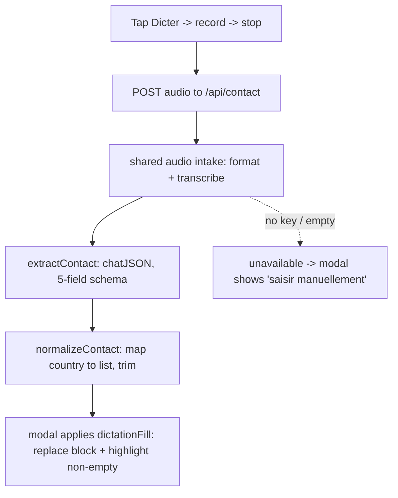

# feat: Voice-fill client address

## Summary

Add a "Dicter" recorder, inline below the "Nouveau client" title, that records a short voice note, transcribes and extracts the **address block** (Nom, Adresse, NPA, Ville, Pays), and fills those modal fields for review. Voice-filled fields are highlighted until edited; e-mail and phone stay typed; nothing is created until the builder taps "Créer le client."

## Problem Frame

Creating a client today is all typing — a builder on site thumbs five address fields into a modal on a phone, the slowest part of the create flow. The app already records → transcribes → extracts for quotes; that pipeline maps cleanly onto the address block, where street and town names dictate far more reliably than they type. See `origin: docs/brainstorms/2026-06-10-voice-fill-client-address-requirements.md`.

---

## Requirements

R-IDs mirror the origin requirements doc for traceability.

- R1. The new-client modal offers a tap-to-record / tap-to-stop voice action ("Dicter").
- R2. After recording, the note is transcribed and the address block extracted: Nom, Adresse, NPA, Ville, Pays.
- R3. Extracted values populate the matching editable fields, each still editable.
- R4. A field the model did not clearly hear is left blank — never guessed.
- R5. A spoken country is mapped to the existing country list; a country outside that list leaves Pays blank.
- R6. E-mail and phone are not populated by voice; they remain typed.
- R7. Each field populated by the dictation is highlighted; the highlight clears when that field is edited.
- R8. Re-recording replaces the address-block fields with the new dictation and re-applies the highlights, leaving any typed e-mail/phone untouched.
- R9. No client is created from the dictation; creation still requires "Créer le client."
- R10. When transcription/extraction is unavailable or yields nothing, the form is left unchanged and the builder is told to enter details manually.

---

## Key Technical Decisions

- **Dedicated `app/api/contact/route.ts` endpoint, not an extension of `app/api/quote/route.ts`.** The two routes overlap only on audio intake (~10 lines); downstream the quote route loads catalog candidates, runs `extractQuote` + `finishQuote`, and falls back to the Amina fixture — all quote-specific. A separate route keeps each single-responsibility and gives contact its own response contract and keyless behavior. (resolves origin Outstanding Question)
- **Shared audio-intake helper.** Lift the `mime → format` conversion and the base64 + `transcribeAudio` call into `src/llm/audio.ts`, consumed by both the contact route and the quote route, so the dedicated endpoint adds no duplicated plumbing.
- **Lightweight tap/stop recorder, inline below the modal title.** A small recorder module (record/stop button + status) sits at the top of the modal body. No waveform, timer, file-upload, or screen wake lock — a ~10-second note doesn't need the full `/new` capture UI.
- **Each dictation replaces the whole address block; highlight only non-empty filled fields.** One rule satisfies replace-on-re-record (R8), unheard→blank (R4), and unmatched-country→blank (R5/AE4): set all five fields to the returned values (blank where not heard, which also clears the default "Suisse" when no country is spoken), and highlight only those that came back non-empty.
- **Code owns determinism; the model emits language only.** The model returns the five address strings as spoken; code maps the spoken country to the list, trims, and decides fill/highlight. Follows `docs/solutions/architecture-patterns/code-owns-determinism-llm-owns-language.md` and the project Parse contract.
- **Never auto-create.** Voice only fills editable fields; the builder confirms spelling and taps Créer (CLAUDE.md rule #2; see origin Key Decisions).

---

## High-Level Technical Design

Deterministic core (`src/contact.ts`, `src/countries.ts`) and the LLM call (`src/llm/contact.ts`) mirror the existing split between `src/quote/*` and `src/llm/extraction.ts`.

---

## Implementation Units

### U1. Deterministic contact core

- **Goal:** Pure, tested functions for country mapping, normalization, and the fill/highlight decision — independent of React and the network.
- **Requirements:** R4, R5, R6, R8.
- **Dependencies:** none.
- **Files:** `src/countries.ts` (new — move the `COUNTRIES` name list here), `app/lib/countries.ts` (modify — re-export `COUNTRIES`/`COUNTRY_OPTIONS` from `src/countries.ts` so existing component imports are unchanged), `src/contact.ts` (new), `src/contact.test.ts` (new).
- **Approach:** `src/contact.ts` defines a `ContactFields` shape (the five address strings). `normalizeContact(raw)` trims each field and maps the spoken country to a `COUNTRIES` entry (case-insensitive) or `""` when unmatched/empty. `dictationFill(fields)` returns the field values to set plus the list of keys that are non-empty (the ones to highlight). Move only the `COUNTRIES` array to `src/countries.ts`; keep `COUNTRY_OPTIONS` derivation re-exported from `app/lib/countries.ts`.
- **Patterns to follow:** `src/phone.ts` (pure, src-level, unit-tested helper) and the deterministic adapters in `src/quote/`.
- **Test scenarios:**
  - `normalizeContact` maps "France" → "France" and "portugal" → "Portugal" (case-insensitive). Covers R5.
  - `normalizeContact` maps an out-of-list country ("Maroc") → "" and an empty/absent country → "". Covers R5, AE4.
  - `normalizeContact` trims surrounding whitespace on all five fields.
  - `dictationFill` returns all five keys and highlights only the non-empty ones (e.g. NPA empty → present but not highlighted). Covers R4, R7, AE1.
  - `dictationFill` never emits e-mail or phone keys. Covers R6.
- **Verification:** `npm test` passes with the new `src/contact.test.ts`; `app/lib/countries.ts` consumers (`ClientFormModal`, `ClientDetail`, `CompanyForm`) still typecheck.

### U2. Contact extraction via OpenRouter

- **Goal:** Turn a transcript into the raw address block, faithfully (language only, blank when not heard).
- **Requirements:** R2, R4.
- **Dependencies:** U1.
- **Files:** `src/llm/contact.ts` (new).
- **Approach:** `extractContact(transcript)` calls `chatJSON` with a strict 5-field JSON schema (name, address, postcode, city, country — all strings, empty when not spoken) and a faithful system prompt that forbids guessing or inventing detail. Returns `normalizeContact(raw)`. Mirrors `extractQuote` in `src/llm/extraction.ts` (system prompt + `chatJSON` + a raw→clean adapter), minus catalog/trade.
- **Patterns to follow:** `src/llm/extraction.ts` (`extractQuote`, `rawToExtracted`, strict schema shape), `chatJSON` in `src/llm/client.ts`.
- **Test scenarios:**
  - Given a mocked `chatJSON` returning a full raw contact, `extractContact` returns the normalized five fields. Covers R2.
  - Given a mocked raw contact with an empty street, the normalized result keeps street blank (no guess). Covers R4.
  - `Test expectation:` the live model call is not unit-tested (covered manually); the schema/prompt shape is asserted structurally.
- **Verification:** Unit test with a mocked `chatJSON` passes; manual smoke against a real note fills plausible fields.

### U3. `/api/contact` route + shared audio intake

- **Goal:** A public, rate-limited endpoint that takes audio and returns the address block, with a graceful keyless path.
- **Requirements:** R2, R10.
- **Dependencies:** U2.
- **Files:** `src/llm/audio.ts` (new — `audioFormat` + an `audioToTranscript(file)` helper), `app/api/quote/route.ts` (modify — use the shared helper in place of the inline `audioFormat`), `app/api/contact/route.ts` (new).
- **Approach:** Move `audioFormat` out of the quote route into `src/llm/audio.ts` and add `audioToTranscript(file)` (format → base64 → `transcribeAudio`). The contact route: rate-limit per IP (same `clientIp`/`rateLimit` as `/api/quote`), parse the `audio` file, `audioToTranscript`, `extractContact`, return JSON `{ name, address, postcode, city, country }`. When `hasOpenRouterKey()` is false or the transcript is empty, return a flagged "unavailable" response (no fixture) so the modal can fall back to manual entry.
- **Patterns to follow:** `app/api/quote/route.ts` (rate-limit guard, multipart audio parsing, `runtime = "nodejs"`, keyless handling), `app/api/clients/route.ts` (POST/error shape).
- **Test scenarios:**
  - `audioFormat` maps representative mime types ("audio/webm;codecs=opus" → "webm", "audio/mp4" → "m4a") in `src/llm/audio.test.ts`.
  - Route returns the five fields for a transcript (extract path mocked); route returns the unavailable flag when no key is configured. Covers R2, R10. (Route-level scenarios are integration-shaped — the repo has no route-test harness, so verify via the mocked helpers plus manual run.)
- **Verification:** Quote flow still works after the `audioFormat` move (manual record on `/new`); `curl`/manual POST to `/api/contact` returns the address fields; keyless dev run returns the unavailable flag.

### U4. AddressDictation recorder component

- **Goal:** A self-contained tap/stop recorder that posts to `/api/contact` and hands back the extracted fields.
- **Requirements:** R1, R10.
- **Dependencies:** U3.
- **Files:** `app/components/AddressDictation.tsx` (new).
- **Approach:** A small component: a mic button toggling record/stop via `MediaRecorder`, a compact status line (idle / "En écoute" / "Analyse…" / error), build the blob on stop, POST to `/api/contact`, and call `onResult(fields)` on success. No waveform, timer, file-upload, or screen wake lock. On the unavailable flag or any failure, surface a short message and leave the caller's fields untouched (`onResult` not called).
- **Patterns to follow:** the `MediaRecorder` start/stop and blob assembly in `app/new/page.tsx` (`startRecording`/`stopRecording`/`onstop`) — reused without the waveform, elapsed timer, or wake-lock effect.
- **Test scenarios:** `Test expectation: none — browser media capture; verified manually.` The deterministic result handling lives in U1 (`dictationFill`) and U5.
- **Verification:** On a device, tapping records and stops; a spoken address returns fields; denying mic or a failed call shows the error and changes nothing.

### U5. Wire dictation into the client modal

- **Goal:** Place the recorder in the modal and apply its result to the address fields with review highlighting.
- **Requirements:** R3, R4, R5, R7, R8, R9.
- **Dependencies:** U1, U4.
- **Files:** `app/components/ClientFormModal.tsx` (modify).
- **Approach:** Render `AddressDictation` inline directly below the "Nouveau client" title. Track a `highlighted` set of field keys in modal state. On a dictation result, run `dictationFill` (U1): replace all five address fields in `draft` and set `highlighted` to the non-empty keys (replacing any prior set). In `set(field, …)`, remove that field from `highlighted` so editing clears its highlight. Reset `highlighted` when the modal opens. Leave the e-mail and phone fields (and their `PhoneInput`) untouched. Apply a highlight style (e.g. a tinted ring/background) to fields in the set.
- **Patterns to follow:** existing `ClientFormModal` draft state + `set` helper; the highlight cue can mirror the warm review styling already used elsewhere.
- **Test scenarios:**
  - Editing a voice-filled field removes it from the highlighted set (pure helper-level). Covers R7, AE2.
  - A second dictation replaces the address fields and the highlighted set; a typed phone is unchanged. Covers R8, AE3.
  - The deterministic replace/highlight is asserted via U1's `dictationFill`; modal binding (render + `set` wiring) is verified manually.
- **Verification:** Dictate into a new client → address fields fill and highlight, e-mail/phone empty; edit a field → its highlight clears; re-dictate → block replaced; tap Créer → client created (no auto-create before that).

---

## Acceptance Examples

Carried from origin; each is enforced by the cited unit's test scenarios.

- AE1. No NPA spoken → NPA blank and unhighlighted; spoken Ville filled and highlighted. (U1)
- AE2. Editing a voice-filled Ville clears its highlight. (U5)
- AE3. Re-recording replaces the address fields and re-highlights; a typed phone is unchanged. (U5)
- AE4. Spoken "Portugal" → Pays set to the list entry; a country not in the list → Pays blank. (U1)
- AE5. Transcription unavailable → fields unchanged and a "saisir manuellement" message shown. (U3, U4)

---

## Scope Boundaries

Deferred for later (from origin):

- Voice capture of e-mail and phone.
- Dictating into an existing client on the detail page — this plan is the create-modal flow only.
- A conversational clarification loop — the form stays a form.

Deferred to follow-up work:

- Refactoring `app/new/page.tsx` to consume a shared recorder hook — out of scope; the recorder here is purpose-built for the modal and the `/new` capture stays as-is.

---

## Risks & Dependencies

- **Paid-call surface.** `/api/contact` fronts paid STT + LLM like `/api/quote`; it carries the same per-IP rate limit. No new secret — reuses `OPENROUTER_API_KEY`.
- **Mis-heard fields.** Mitigated by highlight + human review + never-auto-create; deterministic country mapping prevents a misheard country from creating a junk value (unmatched → blank).
- **Quote-route refactor.** Moving `audioFormat` into `src/llm/audio.ts` touches the working quote route; verify the `/new` capture still functions (U3 verification).

---

## Sources & Research

- Origin requirements: `docs/brainstorms/2026-06-10-voice-fill-client-address-requirements.md`.
- Pipeline to mirror: `app/api/quote/route.ts` (audio intake, rate limit, keyless fallback), `src/llm/client.ts` (`transcribeAudio`, `chatJSON`), `src/llm/extraction.ts` (`extractQuote` + raw→clean adapter pattern).
- Determinism boundary: `docs/solutions/architecture-patterns/code-owns-determinism-llm-owns-language.md`.
- Reuse: `src/phone.ts` (src-level tested helper pattern), `app/lib/countries.ts` (country list), `app/components/ClientFormModal.tsx` (draft/set surface), `app/new/page.tsx` (`MediaRecorder` start/stop).
