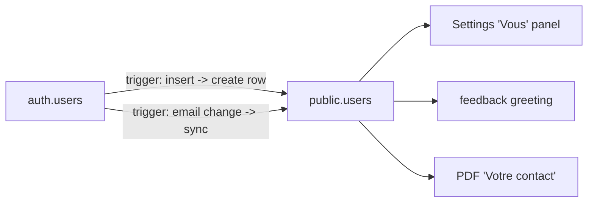
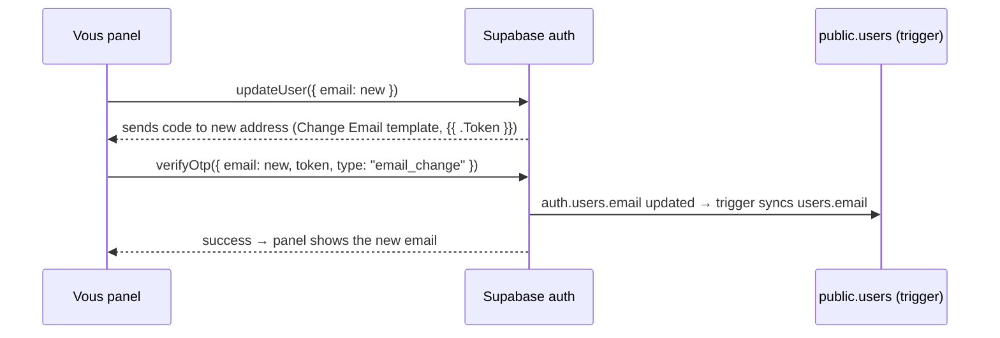

# feat: Users table — person profile, person-level contact

## Summary

Introduce a `users` table that owns the **person** operating the account — first name, last name, email, phone — auto-created for every signed-up user and backfilled for existing ones, each user reading/writing only their own row. Email is the single login-and-contact email, changeable in Settings via the same code flow as sign-in. First/last name move off `company_profile` onto the user; email and phone become person-level (dropped from the company surfaces and the PDF header). A new Settings "Vous" panel edits the user; the feedback greeting and the quote PDF's new "Votre contact" block both read from it.

## Problem Frame

Today `owner_id` (the auth user) is the only identity, and `company_profile` quietly doubles as both the company and the person — name, email, and phone sit on a company row. But the person on the ground writing and sending a quote is the entity that matters: their email is what a client replies to, regardless of any company above them. Before billing arrives, we want a clean base of *users* (the future payers), with the company demoted to just business details. Companies and multi-account-per-company come later — this slice establishes the person as first-class.

---

## Requirements

- R1. A `users` table holds first_name, last_name, email, phone, keyed 1:1 to the auth user.
- R2. A row is created automatically for every user at signup, and existing users are backfilled.
- R3. A user can read and update only their own row (RLS).
- R4. Email is the single login-and-contact email — sourced from auth, mirrored into `users.email`, kept in sync.
- R5. Settings has a "Vous" panel that edits the user's first name, last name, and phone.
- R6. The "Vous" panel changes the email via a "Modifier" that sends a code to the new address and confirms it — the same code experience as sign-in.
- R7. First/last name are removed from `company_profile`; email and phone are dropped from the company settings panel and the PDF company header (they're person-level now).
- R8. The feedback confirmation greets by the user's first name; Slack attributes the full person name.
- R9. The quote PDF gains a "Votre contact" block (user name / email / phone) below the company header.
- R10. The future `company_id` link and any re-scoping of other data are out of scope.

---

## Key Technical Decisions

- **The person is `users`, auto-provisioned by a DB trigger.** A trigger on `auth.users` creates the matching `public.users` row at signup (and syncs email on change), so the user base is complete by construction, not only when someone opens Settings. Existing auth users are backfilled.
- **Auth owns the email; `users.email` mirrors it.** One email, not two. `users.email` is never written by app code — the email-sync trigger keeps it current. `saveUser` writes only first/last/phone.
- **Email change = Supabase email-change OTP, code UX.** The "Vous" panel calls `updateUser({ email })` then `verifyOtp({ type: "email_change" })` via the browser client, reusing the sign-in code experience. **Depends on config:** the **"Change Email Address"** email template must render `{{ .Token }}` (a *separate* template from the sign-in one), and "Secure email change" is OFF (done) so a single code goes to the new address. Without the token, Supabase sends a link, not a code (see `docs/solutions/integration-issues/supabase-email-otp-magic-link-not-code.md`).
- **Email & phone are person-level.** Drop first/last name from `company_profile`; remove email/phone from the company settings panel and the PDF company header. **Keep** the `company_profile.email`/`phone` columns (unused) rather than a destructive drop, and **seed** `users.phone` from the existing company phone during backfill.
- **A dedicated `users` data layer + route**, mirroring `company`, keeps the person CRUD separate from the company CRUD.

---

## High-Level Technical Design

Person identity and its sync with auth:

Email change (code UX), all client-side via the browser Supabase client:

---

## Implementation Units

### U1. `users` table, RLS, trigger, backfill

- **Goal:** The table, its security, auto-provisioning, and a clean migration of existing data.
- **Requirements:** R1, R2, R3, R4, R7.
- **Dependencies:** none.
- **Files:** `supabase/migrations/0015_users_table.sql` (new).
- **Approach:** Create `public.users` (id uuid PK referencing `auth.users(id)` on delete cascade; first_name, last_name, email, phone text; created_at, updated_at). Enable RLS with select+update policies `id = auth.uid()` (no client insert — the trigger owns creation). A `SECURITY DEFINER` trigger function on `auth.users`: AFTER INSERT → insert `public.users(id, email)`; AFTER UPDATE OF email → update `public.users.email`. Backfill: insert a row for every existing `auth.users`; move the single `company_profile.first_name/last_name` into the matching user; seed `users.phone` from `company_profile.phone`. Then drop `first_name`/`last_name` from `company_profile` (added in 0014); leave `company_profile.email`/`phone` columns in place but unused.
- **Patterns to follow:** existing migrations in `supabase/migrations/` (0008 RLS, 0014 column adds); the Supabase auth-trigger pattern (security definer + grants).
- **Test scenarios:** `Test expectation: none — SQL migration; verified by execution.`
  - Verify: after apply, a `public.users` row exists for each `auth.users` row; a fresh signup auto-creates one; RLS blocks selecting another user's row; the pilot's name/phone landed on their user row; `company_profile` no longer has the name columns.
- **Verification:** Run via the Supabase MCP; confirm row parity, the trigger fires on a test signup, and a cross-user select returns nothing.

### U2. Users data layer + API; strip person fields from company

- **Goal:** `getUser`/`saveUser` and a save route; remove person fields from the company types/route.
- **Requirements:** R1, R4, R5, R7.
- **Dependencies:** U1.
- **Files:** `src/db/users.ts` (new), `src/db/users.test.ts` (new), `src/db/types.ts` (modify — add `UserRow`, remove first/last from `CompanyRow`), `app/api/users/route.ts` (new), `src/db/company.ts` (modify — drop first/last from `SaveCompanyInput`/save row), `app/api/company/route.ts` (modify — drop first/last from the body).
- **Approach:** `UserRow` = id, first_name, last_name, email, phone. `getUser(scope)` selects the owner's row; `saveUser(scope, { first_name, last_name, phone })` updates those three only — **never email** (auth/trigger owns it). `POST /api/users` mirrors `/api/company` (requireOwner → saveUser). Revert the `company_profile` first/last wiring added earlier this session.
- **Patterns to follow:** `src/db/company.ts` (getCompany/saveCompany), `app/api/company/route.ts`.
- **Test scenarios:**
  - `saveUser` updates first/last/phone and does not send an `email` field. Covers R4.
  - `getUser` returns the row for the scoped owner (mocked supabase, mirroring `src/db/quotes.test.ts`).
- **Verification:** `npm test` passes `src/db/users.test.ts`; company typecheck no longer references the removed name fields.

### U3. Settings "Vous" panel (name + phone)

- **Goal:** A user-editing panel above the company panel; the company panel becomes company-only.
- **Requirements:** R5, R7.
- **Dependencies:** U2.
- **Files:** `app/settings/UserForm.tsx` (new), `app/settings/page.tsx` (modify — fetch the user, render `UserForm` above `CompanyForm`), `app/settings/CompanyForm.tsx` (modify — remove the "Vous" name fields added earlier; company stays name/address/VAT/logo, no email/phone).
- **Approach:** `UserForm` edits first name, last name, phone (`PhoneInput`) and posts to `/api/users`; shows the email read-only with a "Modifier" affordance (the flow itself is U4). The Settings page fetches both user and company and renders the two panels.
- **Patterns to follow:** `app/settings/CompanyForm.tsx` (form + submit + saved state), `app/components/PhoneInput.tsx`, the "Vous" panel layout from this session.
- **Test scenarios:** `Test expectation: none — form UI; verified manually.` Save logic is covered by U2's `saveUser` test.
- **Verification:** Settings shows "Vous" (name/phone/email) above "Profil de l'entreprise"; editing name/phone saves to the user; the company panel no longer shows email/phone.

### U4. Change-email-by-code flow

- **Goal:** Let the user change their login/contact email with a code, in the "Vous" panel.
- **Requirements:** R6, R4.
- **Dependencies:** U3.
- **Files:** `app/settings/UserForm.tsx` (modify), optionally a small `app/components/EmailChange.tsx` (new) for the email→code sub-flow.
- **Approach:** "Modifier" reveals a new-email input → `browserClient().auth.updateUser({ email })` sends the code → a code input → `verifyOtp({ email: new, token, type: "email_change" })`. On success, reflect the new email (the trigger has synced `users.email`). Mirror `AuthOtp`'s two-step email→code shape and styling, but with the email-change API (single `type: "email_change"`, no dual fallback). Surface clear errors for an expired/incorrect code.
- **Patterns to follow:** `app/components/AuthOtp.tsx` (email→code UX, error copy), `src/db/supabase/browser.ts` (`browserClient`).
- **Test scenarios:** `Test expectation: none — Supabase auth round-trip; verified manually.`
  - Manual: change email → a code arrives at the **new** address → entering it updates the email; an expired/wrong code shows the right error.
- **Verification:** End-to-end against Supabase (with the "Change Email Address" template carrying `{{ .Token }}`): the email changes and persists across reload; `users.email` reflects it.

### U5. Feedback greeting from the user

- **Goal:** Greet by the user's first name; attribute the full person name in Slack.
- **Requirements:** R8.
- **Dependencies:** U2.
- **Files:** `app/api/feedback/route.ts` (modify).
- **Approach:** Resolve the sender via `getUser` instead of `getCompany`: greet name = `users.first_name`; Slack name = "First Last" (fallback to email). Email stays the session email.
- **Patterns to follow:** the current resolution block in `app/api/feedback/route.ts`; `src/feedback.ts` `buildSlackMessage` is unchanged.
- **Test scenarios:** `Test expectation: none — route glue; the payload builder is already covered by src/feedback.test.ts.`
- **Verification:** A feedback note shows "Merci {prénom} !" and Slack shows the full name.

### U6. PDF "Votre contact" block

- **Goal:** Print the person's contact under a company header that no longer carries email/phone.
- **Requirements:** R9, R7.
- **Dependencies:** U2.
- **Files:** `app/components/QuoteDocument.tsx` (modify), `app/api/quotes/[id]/pdf/route.ts` (modify — fetch the user).
- **Approach:** The PDF route fetches the owner's user and passes it to `renderQuotePdf`. The company header renders name/address/NPA Ville/Pays/TVA only (drop email/phone). Add a "Votre contact" block below it: "Prénom Nom", then "email · phone". Omit lines that are empty.
- **Patterns to follow:** `app/components/QuoteDocument.tsx` (the company `View` + styles), `src/db/users.ts` `getUser`.
- **Test scenarios:** `Test expectation: none — react-pdf rendering; verified by generating a PDF.`
  - Verify: the company block shows no email/phone; the "Votre contact" block shows the user's name/email/phone; a user with no phone shows name + email only.
- **Verification:** Generate a PDF for a quote with a client attached; the layout matches (company details, then Votre contact).

---

## Acceptance Examples

- AE1. A new signup → a `users` row exists with their email (trigger). (U1)
- AE2. Editing first/last/phone in "Vous" saves to the user, not the company. (U2, U3)
- AE3. "Modifier" email → enter new address → code to the new address → enter it → email updated and persisted; `users.email` reflects it. (U4)
- AE4. Feedback → "Merci {prénom} !" and Slack shows the full person name. (U5)
- AE5. PDF → company header without email/phone, then a "Votre contact" block with the user's name/email/phone. (U6)
- AE6. User A cannot read user B's row. (U1)

---

## Scope Boundaries

Not in scope:

- The `companies`/multi-account model and a `company_id` on `users` — a later slice. No re-scoping of quotes/clients/articles (still `owner_id`).
- Changing the *login* email through any path other than the code flow above.
- Dropping the now-unused `company_profile.email`/`phone` columns (kept to avoid a destructive migration; can be removed later).

---

## Risks & Dependencies

- **Email-change template (config, not code).** The "Change Email Address" template must render `{{ .Token }}` or the user gets a link, not a code — the exact gotcha in `docs/solutions/integration-issues/supabase-email-otp-magic-link-not-code.md`. The sign-in template is already correct; this is a separate template. "Secure email change" is OFF (single code to the new address).
- **Built-in email sender is rate-limited / not for production** (per the same learning) — wire custom SMTP before launch or change-email emails get throttled.
- **Auth trigger** needs `SECURITY DEFINER` and correct grants to write `public.users` from the `auth` schema — a known Supabase pattern; get it wrong and signups fail. Backfill must be idempotent.
- **Data move** is one-way (name off company onto user); near-zero data today, but the backfill must run in the same migration as the column drop so nothing is orphaned.

---

## Sources & Research

- `docs/solutions/integration-issues/supabase-email-otp-magic-link-not-code.md` — the OTP-template/`verifyOtp`-type gotcha that governs the email-change flow.
- Patterns: `app/components/AuthOtp.tsx` (email→code), `src/db/supabase/browser.ts` (`browserClient`), `src/db/company.ts` + `app/api/company/route.ts` (data-layer/route shape), `app/api/feedback/route.ts` (greeting), `app/components/QuoteDocument.tsx` + `app/api/quotes/[id]/pdf/route.ts` (PDF), `supabase/migrations/` (migration + RLS conventions).
