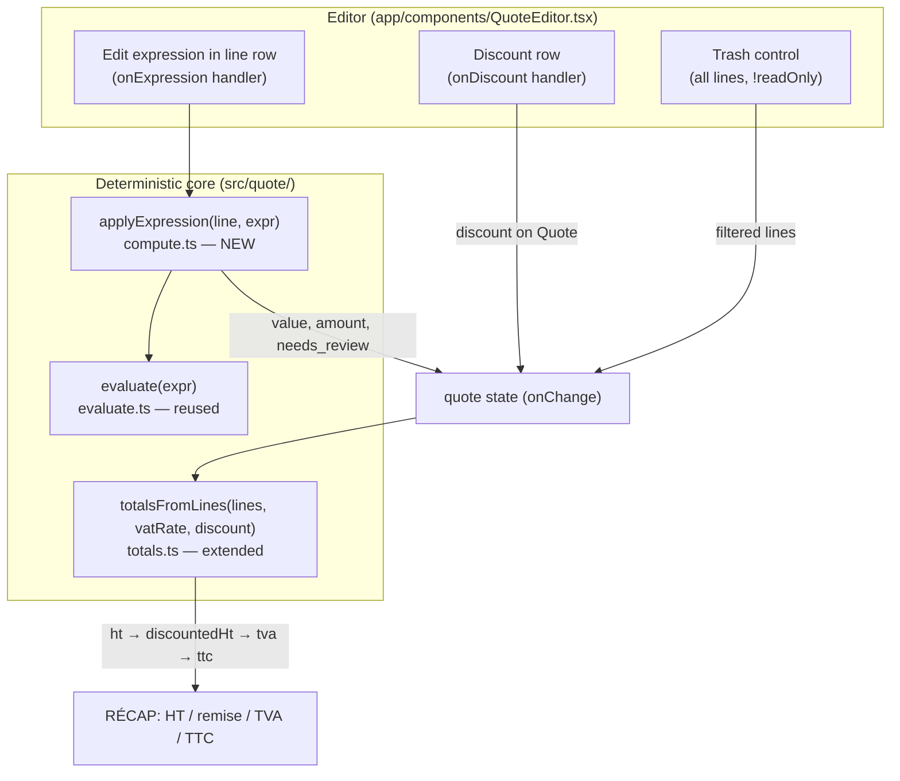

# feat: CGV settings, per-devis discount, inline formula edit, delete-any-line

## Summary

Four quote-editing improvements surfaced from real on-site use of Kobio, planned as one
slice because they cluster in the same three layers: the deterministic compute core
(`src/quote/`), the quote editor UI (`app/components/QuoteEditor.tsx`,
`app/quotes/[id]/SavedQuoteEditor.tsx`), and per-user/quote persistence (`company_profile`
and `quotes` tables).

1. **Delete any line** — fix the bug where parsed (non-forfait) prestation lines have no
   trash control.
2. **Inline formula edit** — let the user edit a line's calculation expression directly in
   the row, re-evaluated through the existing deterministic evaluator, instead of round-tripping
   through the transcript.
3. **Per-devis discount (remise)** — a single quote-level discount (percentage *or* fixed
   amount) applied to HT before TVA, flowing through HT/TVA/TTC.
4. **Conditions générales (CGV)** — store general terms once in settings; render them on the
   quote output.

This plan covers the **app + compute + render** layers only. Bexio draft-offer write-back is
deferred (build rule #3 is "next" and unbuilt) — each feature leaves a clean seam for the
eventual Bexio mapping rather than building it. Catalog-learning / prediction logic stays out
per the build rules.

---

## Problem Frame

Nicolas used Kobio on a live job and hit four friction points, captured verbatim in the Notion
backlog:

- He couldn't delete a prestation after going back in the flow — the corbeille was gone. Code
  review traced this to the delete control being gated to `isForfait` lines only; parsed lines
  (the bulk of a dictated quote) never expose it.
- To fix a number he had to scroll to the transcript "text en bas" and *Recalculer*, which
  re-extracts and **wipes all lines**. He wants to edit the formula where the line lives.
- No first-class way to apply a discount, so a remise would have to be faked as a line item —
  which corrupts faithful transcription and the override log.
- General terms (CGV) have to be re-stated per quote instead of stored once.

These are independent in behavior but share files and the same correctness constraint: **code
owns the numbers, the deterministic core stays the single source of arithmetic truth** (CLAUDE.md
hard rule 1, "Parse contract").

---

## Requirements

- **R1** — Any prestation line (forfait or parsed) can be removed from the editor when the quote
  is editable; the trash control appears on all line types.
- **R2** — A line's calculation expression is editable inline in its row. On edit, the line's
  `value` and `amount` are recomputed by the existing deterministic evaluator; a malformed
  expression flags `needs_review` rather than crashing or silently zeroing.
- **R3** — Inline formula edits are a line-level override: they win for that line and do not
  require touching the transcript. (Existing behavior preserved: a subsequent transcript
  *Recalculer* re-extracts all lines — that destructive round-trip is unchanged and out of scope.)
- **R4** — A quote carries an optional single discount: either a percentage or a fixed CHF
  amount, applied to HT **before** TVA. HT/TVA/TTC reflect it; the Amina gate (no discount) still
  reproduces TTC 4'715.60 exactly.
- **R5** — The discount is persisted with the quote and survives reload.
- **R6** — A user can store CGV text once in settings (per owner, alongside company profile).
- **R7** — Stored CGV renders on the quote output (PDF). Absence of CGV renders nothing (no empty
  block).
- **R8** — All four features respect the lock model: no edits (delete, formula, discount) when the
  quote is read-only (`isAccepted`). Lock semantics are unchanged by this plan.

**Success criteria:** all existing `src/quote/` tests stay green; new compute/totals tests cover
discount and inline-formula recompute; the four friction points are resolved in the editor;
nothing writes to Bexio.

---

## Key Technical Decisions

- **KTD-1 — Discount lives at the Quote level and is applied in `totalsFromLines`.** A single
  global discount (not per-line) keeps the schema and compute change small and centralizes the
  arithmetic in the one function that already assembles HT/TVA/TTC (`src/quote/totals.ts:28`).
  Per-line discounts were rejected as heavier on schema and compute for no field-validated need
  (see origin call-out, confirmed with user).
- **KTD-2 — Discount supports both percentage and fixed amount, applied to HT before TVA.**
  Swiss-standard treatment (remise reduces the net, VAT computed on the discounted net). Modeled as
  a discriminated union `{ kind: "percent" | "fixed", value: number } | null` so the two modes are
  type-distinct and the null case is explicit.
- **KTD-3 — Inline formula edit reuses `evaluate()` directly; recompute is a pure helper in
  `compute.ts`.** `evaluate()` is already pure, deterministic, and rejects malformed input loudly
  (`src/quote/evaluate.ts:68`). A new `applyExpression(line, expr)` helper evaluates and sets
  `value`/`amount`/`needs_review`, mirroring the expression branch of `computeLine` so the UI never
  does arithmetic.
- **KTD-4 — CGV is a column on `company_profile`, not a new table.** It's a single per-owner text
  blob that sits naturally beside `vat_rates`/`vat_number`; mirrors the `0011_configurable_vat_rates`
  migration pattern and the `getCompany/saveCompany` upsert path.
- **KTD-5 — Bexio mapping is deferred with a seam, not built.** Discount and CGV both have an
  eventual Bexio offer target, but write-back is unbuilt. The Quote/Company types carry the fields;
  the Bexio client is untouched. (See origin call-out, confirmed with user.)
- **KTD-6 — Delete-any-line is a pure gate change.** `removeLine` is already index-generic
  (`QuoteEditor.tsx:105`); only the render condition at `:207` is wrong. No state-model change.

---

## High-Level Technical Design

Where the two compute-touching features slot into the existing deterministic pipeline. The core
invariant — UI emits intent, `src/quote/` owns every number — is preserved at both new seams.

Malformed-expression path: `applyExpression` catches `evaluate()` throwing, leaves `amount` at its
prior value or 0, and sets `needs_review = true` — same loud-flag posture as the existing
`computeLine` fallback (`compute.ts:68`).

---

## Implementation Units

### U1. Delete any prestation line

**Goal:** Parsed (non-forfait) lines expose the trash control, so any line can be removed when the
quote is editable.

**Requirements:** R1, R8.

**Dependencies:** none.

**Files:**
- `app/components/QuoteEditor.tsx` (modify — delete-button render condition ~:207)
- `app/components/QuoteEditor.test.tsx` or nearest component test (create/extend — see note)

**Approach:** Change the render guard from `isForfait && !readOnly` to `!readOnly` at
`QuoteEditor.tsx:207`. `removeLine(i)` (`:105`) already filters by index and works for any line
kind. Verify the absolutely-positioned trash button (`top-2.5 right-2.5`) doesn't collide with the
parsed-line layout (description textarea + expression pill + quantity/rate inputs); nudge position
only if it overlaps the expression pill. Deleting a parsed line is an explicit human override — no
transcript change, no override-log entry (the override log tracks price overrides, not line removal).

**Patterns to follow:** existing forfait delete button and `removeLine` handler in the same file.

**Test scenarios:**
- Parsed line (`quantity.kind === "area"`, has `expression`) renders a trash control when
  `readOnly === false`.
- Clicking it calls `onChange` with that line removed and all other lines intact (index integrity:
  removing line 1 of 3 leaves originals 0 and 2 in order).
- Forfait line still renders and deletes (no regression).
- `readOnly === true` (accepted quote): no trash control on any line.

**Verification:** In the editor, a dictated parsed line shows a corbeille and can be deleted;
totals recompute from the remaining lines.

---

### U2. Inline formula editing on prestation lines

**Goal:** The user edits a line's calculation expression in its row; the line's value and amount
recompute deterministically, without touching the transcript.

**Requirements:** R2, R3, R8.

**Dependencies:** none (independent of U1).

**Files:**
- `src/quote/compute.ts` (modify — add pure `applyExpression(line, expr)` helper)
- `src/quote/compute.test.ts` (extend)
- `app/components/QuoteEditor.tsx` (modify — make the expression pill ~:249–260 an editable input;
  add `onExpression` handler near `onValue`/`onRate` ~:75–84)

**Approach:**
- Add `applyExpression(line: Line, expr: string): Line` in `compute.ts`: trim input; on empty →
  leave line unchanged or clear to needs_review (decide in impl, default: flag); call `evaluate(expr)`
  inside try/catch; on success set `quantity.expression = expr`, `quantity.value = round2(result)`,
  `amount = round2(value * rate)`, clear the expression-derived `needs_review`; on throw set
  `needs_review = true` and leave `amount`/`value` as-was (do not zero silently — surface the flag).
  Mirror the expression branch of `computeLine` (`compute.ts:68`) so rounding rules match exactly.
- In `QuoteEditor`, render the expression for non-forfait lines as a text input (replacing the
  read-only pill at `:249–260`); on change call `onExpression(i, line, raw)` → `patchLine(i, applyExpression(line, raw))`.
  Keep the forfait branch unchanged (forfait has no expression).
- Edit decouples the line from the transcript (line carries its new expression in state); the
  destructive *Recalculer* round-trip is unchanged and still overwrites on demand.

**Execution note:** Implement `applyExpression` test-first — it's pure and the rounding contract is
exact; lock it with a failing test before wiring the UI.

**Patterns to follow:** `computeLine` expression branch (`compute.ts:68`), `evaluate` usage
(`evaluate.ts:85` call site), `onValue`/`onRate`/`patchLine` handler shape (`QuoteEditor.tsx:67–84`).

**Test scenarios (`applyExpression`):**
- Valid edit: `"(5.25 + 2.90 + 7.60) * 2.76"` → `value` rounded to 2dp, `amount = round2(value * rate)`;
  `needs_review` cleared. Covers the faithful-recompute contract.
- fr-CH comma input is handled (decide: normalize commas before `evaluate`, or require dot — mirror
  whatever `evaluate`/`parseNum` already accept; assert the chosen behavior).
- Malformed expression `"5 + "` / `"1.2.3"` / unbalanced parens → `needs_review === true`, no throw
  escapes the helper, prior `amount` not silently replaced by a wrong number.
- Division by zero / non-finite → `needs_review === true`.
- Rate unchanged by an expression edit; only `value`/`amount` move.
- Editing an expression on a line previously flagged for a *different* reason does not clear that
  unrelated flag (only the expression-derived review state is managed here).

**Test scenarios (UI):**
- Typing in the expression input on a parsed line calls `onChange` with the recomputed line.
- Forfait line shows no expression input.
- `readOnly`: expression input disabled.

**Verification:** Edit a line's formula in the row; the line amount and the RÉCAP HT/TVA/TTC update
live; a deliberately broken formula highlights the line as needs-review instead of crashing.

---

### U3. Discount data model + compute + persistence

**Goal:** Represent a quote-level discount, apply it in the totals pipeline before TVA, and persist
it with the quote.

**Requirements:** R4, R5.

**Dependencies:** none (independent; U4 consumes it).

**Files:**
- `src/quote/types.ts` (modify — add `discount?: Discount | null` to `Quote`; define `Discount`
  union)
- `src/quote/totals.ts` (modify — `totalsFromLines` applies discount to HT before TVA; expose
  discounted-HT and discount amount in `Totals`)
- `src/quote/totals.test.ts` (extend)
- `src/quote/gate.test.ts` (extend — assert no-discount path still yields TTC 4'715.60)
- `supabase/migrations/00NN_quote_discount.sql` (create — add `discount jsonb` to `quotes`)
- `src/db/quotes.ts` (modify — read/write `discount` in `getQuote`/save path)
- `src/db/types.ts` (modify — add `discount` to the quote row type)

**Approach:**
- `Discount = { kind: "percent"; value: number } | { kind: "fixed"; value: number }`. `value` is a
  positive number; percent in 0–100, fixed in CHF. Null/absent = no discount.
- Extend `Totals` with `discount_amount` and keep `ht` as the pre-discount sum; add `net` (HT after
  discount) so the RÉCAP can show the line. `totalsFromLines(lines, vatRate, discount = null)`:
  compute `ht`; derive `discount_amount` (`percent` → `round2(ht * value / 100)`, `fixed` →
  `min(value, ht)` guarded so net never goes negative); `net = round2(ht - discount_amount)`;
  `tva = vatRate ? round2(net * vatRate / 100) : 0`; `ttc = round2(net + tva)`. Default arg `null`
  keeps every existing caller and the Amina gate unchanged.
- Migration mirrors `0011_configurable_vat_rates.sql`: `alter table quotes add column discount jsonb;`
  RLS already covers the table via `owner_id`.
- `src/db/quotes.ts`: include `discount` in select and in the upsert/update payload, defaulting to
  null.

**Execution note:** Totals are pure arithmetic with an exact regression anchor — extend
`totals.test.ts` and `gate.test.ts` first.

**Patterns to follow:** `totalsFromLines` (`totals.ts:28`), `0011_configurable_vat_rates.sql`,
`getCompany/saveCompany` upsert shape (`src/db/company.ts:33`) as the analog for the quotes
read/write change.

**Test scenarios:**
- Percent discount: HT 1000, 10% → discount_amount 100, net 900, TVA at 8.1% = 72.90, TTC 972.90.
- Fixed discount: HT 1000, fixed 150 → net 850, TVA 68.85, TTC 918.85.
- Fixed discount exceeding HT is clamped so net ≥ 0 (HT 100, fixed 150 → net 0, TVA 0, TTC 0).
- Null/absent discount → identical to current behavior; **Amina gate still reproduces TTC 4'715.60**.
- 0% VAT with a discount → TVA 0, TTC = net.
- Rounding: percent producing a third decimal rounds to 2dp at `discount_amount` and again at net.
- Persistence round-trip: save a quote with a percent discount, reload via `getQuote`, discount
  matches (covered as a `src/db` test if the suite mocks Supabase; otherwise assert the
  serialization mapping).

**Verification:** Unit tests green including the unchanged Amina gate; a saved quote reloads with its
discount intact.

---

### U4. Discount row in the editor + PDF

**Goal:** Surface the discount as an editable row in the quote editor and render it on the PDF.

**Requirements:** R4, R8.

**Dependencies:** U3.

**Files:**
- `app/components/QuoteEditor.tsx` (modify — discount control + RÉCAP rows after TTC ~:350–368; pass
  `discount`/`onDiscount` props; feed `discount` into the `totalsFromLines` call at `:116`)
- `app/quotes/[id]/SavedQuoteEditor.tsx` (modify — own `discount` state, pass through, include in
  save payload)
- `app/components/QuoteDocument.tsx` (modify — render remise line in totals block when present)

**Approach:**
- Add a discount control in the RÉCAP rail (Option A from research — quote-level math belongs in the
  editor proper, not `summaryExtras`): a mode toggle (% / CHF) plus a number input, shown below TTC.
  On change call `onDiscount(discount | null)`. Clearing the input → null.
- RÉCAP shows: HT, **remise** (− amount), TVA (on net), TTC. Reuse the existing row markup
  (`:318–353`).
- `SavedQuoteEditor` holds `discount` in state (init from loaded quote), passes it down, and includes
  it in the save body alongside lines/vat (mirror how `selectedRate`/lines are saved).
- `QuoteDocument` renders a remise line between line items and TVA when `quote.discount` is present;
  renders nothing when absent.
- Gated by `readOnly` like every other control (`vatLocked`/`readOnly` precedent).

**Patterns to follow:** RÉCAP rows and `summaryExtras` slot (`QuoteEditor.tsx:314–368`), VAT
`RateSelect` control as the analog for a small inline editor, totals block in `QuoteDocument.tsx`
(~:148–163).

**Test scenarios:**
- Entering 10% updates RÉCAP: remise row appears, TVA recomputes on net, TTC drops accordingly.
- Switching mode %→CHF re-applies as fixed; clearing removes the remise row and restores
  pre-discount TTC.
- `readOnly` quote: discount control disabled, remise still displayed if present.
- PDF: a quote with a discount renders a remise line; a quote without renders no remise line.
- Save then reload (integration with U3): the discount persists and re-renders.

**Verification:** Set a discount in the editor; RÉCAP and the generated PDF both reflect it; reload
keeps it.

---

### U5. CGV storage — schema, settings form, persistence

**Goal:** Let the user enter general terms (CGV) once in settings, stored per owner.

**Requirements:** R6.

**Dependencies:** none.

**Files:**
- `supabase/migrations/00NN_company_cgv.sql` (create — `alter table company_profile add column
  cgv_text text;`)
- `src/db/company.ts` (modify — include `cgv_text` in `getCompany` select and `saveCompany` upsert)
- `src/db/types.ts` (modify — add `cgv_text` to the company type)
- `app/api/company/route.ts` (modify — accept `cgv_text` in `CompanyBody`, pass to `saveCompany`)
- `app/settings/CompanyForm.tsx` (modify — add a CGV textarea section)

**Approach:**
- Migration mirrors `0011_configurable_vat_rates.sql`; single nullable text column, RLS already
  scoped by `owner_id`.
- `getCompany`/`saveCompany`: add `cgv_text` to the selected columns and the upsert object
  (`onConflict: "owner_id"` unchanged).
- API route: extend the `CompanyBody` interface and the `saveCompany` call; trim/normalize the
  string; empty → null.
- `CompanyForm`: add a labelled `<textarea>` (multi-line, generous min-height) after the VAT
  fieldset, before the logo, following the existing field markup; wire it into the form's submit
  payload like the other company fields.

**Patterns to follow:** `vat_rates`/`vat_number` fields in `CompanyForm.tsx`, `getCompany`/`saveCompany`
(`src/db/company.ts:19,33`), `app/api/company/route.ts` POST handler.

**Test scenarios:**
- Saving CGV text persists it on `company_profile` for the owner; reloading settings shows it.
- Empty CGV saves as null (no empty-string noise).
- Long multi-paragraph text round-trips intact (newlines preserved).
- API rejects/ignores `cgv_text` of wrong type without 500 (mirror existing body validation).
- `Test expectation` for the migration file itself: none — schema DDL, verified via the db-layer
  round-trip test above.

**Verification:** Enter CGV in settings, reload — text is there; a second account does not see it
(RLS).

---

### U6. Render CGV on the quote output

**Goal:** Stored CGV appears on the generated quote PDF; absence renders nothing.

**Requirements:** R7.

**Dependencies:** U5.

**Files:**
- `app/components/QuoteDocument.tsx` (modify — render `company.cgv_text` block)
- `app/api/quotes/[id]/pdf/route.ts` (verify — `getCompany` already supplies the field; no change
  expected beyond confirming it's passed)

**Approach:**
- `QuoteDocument` already receives `company`. Render a CGV section after the line items / totals
  block (the legally-conventional position) when `company.cgv_text` is non-empty; render nothing
  otherwise. Preserve newlines (split on `\n` into paragraphs for react-pdf, which doesn't honor raw
  line breaks). Keep typography small/secondary — it's a terms block, not a headline.
- Confirm the PDF route passes the company through (research shows it fetches company already at
  `app/api/quotes/[id]/pdf/route.ts`); no functional change if so.

**Patterns to follow:** company/address/VAT blocks in `QuoteDocument.tsx` (~:94–125), totals block
(~:148–163).

**Test scenarios:**
- Company with CGV → PDF/document tree includes the CGV text (assert via the rendered React-PDF
  element tree or a snapshot of the document component, matching however existing PDF rendering is
  tested).
- Company without CGV → no CGV element in the tree (no empty block, no stray heading).
- Multi-paragraph CGV → paragraphs preserved.
- `Test expectation`: if there is no existing test harness for `QuoteDocument`, assert at the
  component level by rendering with/without `cgv_text` and checking presence; note in the PR if PDF
  rendering is currently untested and this is the first such test.

**Verification:** Generate a quote PDF for an account with CGV — the terms appear; for an account
without, the PDF is unchanged.

---

## Scope Boundaries

**In scope:** the four features above across compute, editor UI, persistence, and PDF render.

**Deferred for later (origin intent / build rules):**
- **Bexio draft-offer write-back** of discount and CGV — build rule #3 is "next" and unbuilt. Types
  carry the fields; the Bexio client is untouched. Seam left intentionally (KTD-5).
- **Catalog learning / override-log consumption** for inline formula edits — the override log tracks
  price overrides, not quantity/formula edits; no logging added here (CLAUDE.md "later").

### Deferred to Follow-Up Work (plan-local sequencing)
- **On-screen CGV preview in the editor.** This plan renders CGV on the PDF output (the quote that
  reaches the client). An in-editor read-only preview is a nice-to-have, not field-requested; defer
  unless asked.
- **Per-line discounts.** Rejected in favor of a single quote-level discount (KTD-1); revisit only if
  a real need surfaces.

**Out of scope / non-goals:**
- Changing the lock model (`isSent`/`isAccepted`/`readOnly`). The delete bug is a render-gate fix, not
  a lock-semantics change. The bug ticket noted the user likely hit *validé* (which correctly locks);
  that behavior stays.
- Any change to the destructive transcript *Recalculer* round-trip beyond leaving it intact.

---

## System-Wide Impact

- **Compute core contract:** `totalsFromLines` gains an optional third arg and `Totals` gains fields.
  All existing callers pass two args and keep working (default `null`); the Amina gate is the
  regression anchor. `applyExpression` is additive.
- **DB schema:** two additive, nullable columns (`quotes.discount jsonb`, `company_profile.cgv_text
  text`). No backfill, no destructive change; RLS already covers both tables by `owner_id`.
- **Affected parties:** end users (Nicolas + testers) get the four fixes; no ops/rollout concerns
  beyond running two migrations. No external consumers of these tables today.

---

## Risks & Dependencies

- **Discount arithmetic must not break the Amina gate.** Mitigation: default-null arg, gate test
  asserted unchanged in U3 before any UI work.
- **Inline formula edit could let bad input through.** Mitigation: all recompute flows through
  `evaluate()` (already rejects malformed input) and `applyExpression` flags `needs_review` on throw;
  never silently substitutes a wrong number (hard rule 1).
- **fr-CH decimal commas in the formula input.** Decide normalization explicitly in U2 (match
  existing `evaluate`/`parseNum` behavior) and test it — a silent comma mishandling would be a wrong
  number reaching a client.
- **PDF component may be untested today.** U6 may introduce the first `QuoteDocument` test; if the
  harness is awkward, fall back to a component-tree presence assertion and note it in the PR.
- **Migration sequence number** (`00NN`) must be the next free index under `supabase/migrations/` at
  implementation time — verify against the directory, don't hardcode from this plan.

---

## Sources & Research

- Notion Kobio backlog items (origin): CGV in settings, discount row, inline formula edit, delete-line
  bug — including the code-traced root cause for the delete bug.
- Compute core: `src/quote/types.ts`, `evaluate.ts:68`, `compute.ts:68`, `totals.ts:28`, `parse.ts:14`,
  `overrides.ts`; tests `compute.test.ts`, `totals.test.ts`, `evaluate.test.ts`, `gate.test.ts` (Amina
  TTC 4'715.60).
- Persistence/settings: `app/settings/CompanyForm.tsx`, `src/db/company.ts:19,33`, `app/api/company/route.ts`,
  `supabase/migrations/0011_configurable_vat_rates.sql`, `src/db/quotes.ts:133`, quote schema migrations
  (`0001_core_schema`, `0011`, `0013`).
- Editor flow: `app/components/QuoteEditor.tsx` (render :195–299, `removeLine` :105, delete gate :207,
  totals :116, RÉCAP :314–368), `app/quotes/[id]/SavedQuoteEditor.tsx` (`readOnly={isAccepted}` :347,
  `vat.locked=isSent` :348, `reprocess` :136), `app/components/TranscriptPanel.tsx`, `QuoteDocument.tsx`,
  `app/api/quotes/[id]/pdf/route.ts`.
- Constraints: `CLAUDE.md` (hard rules 1–3, build order), `refs/quote-schema.md` (Parse contract).
